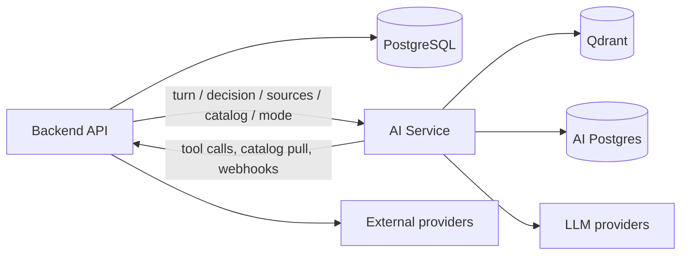
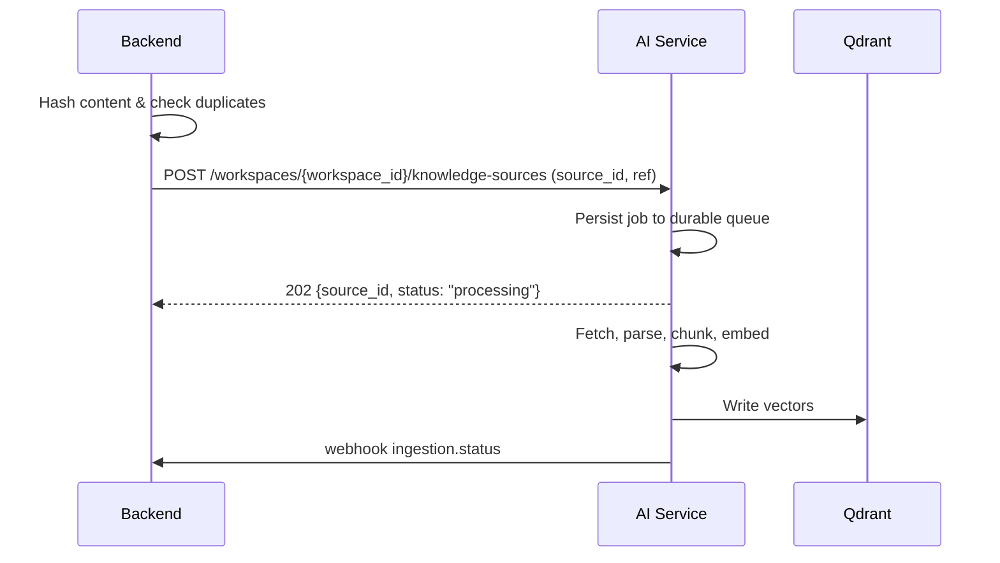
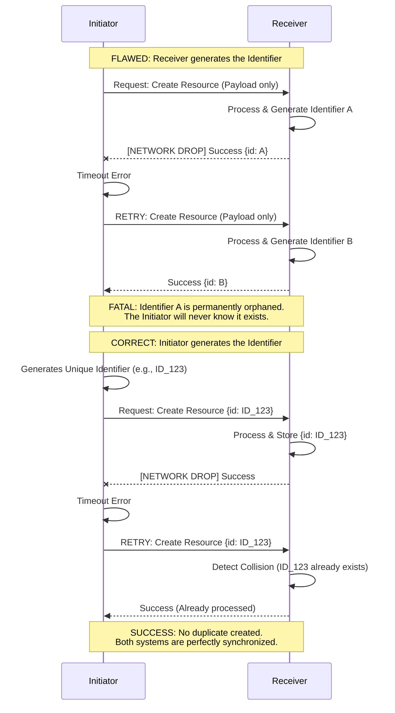
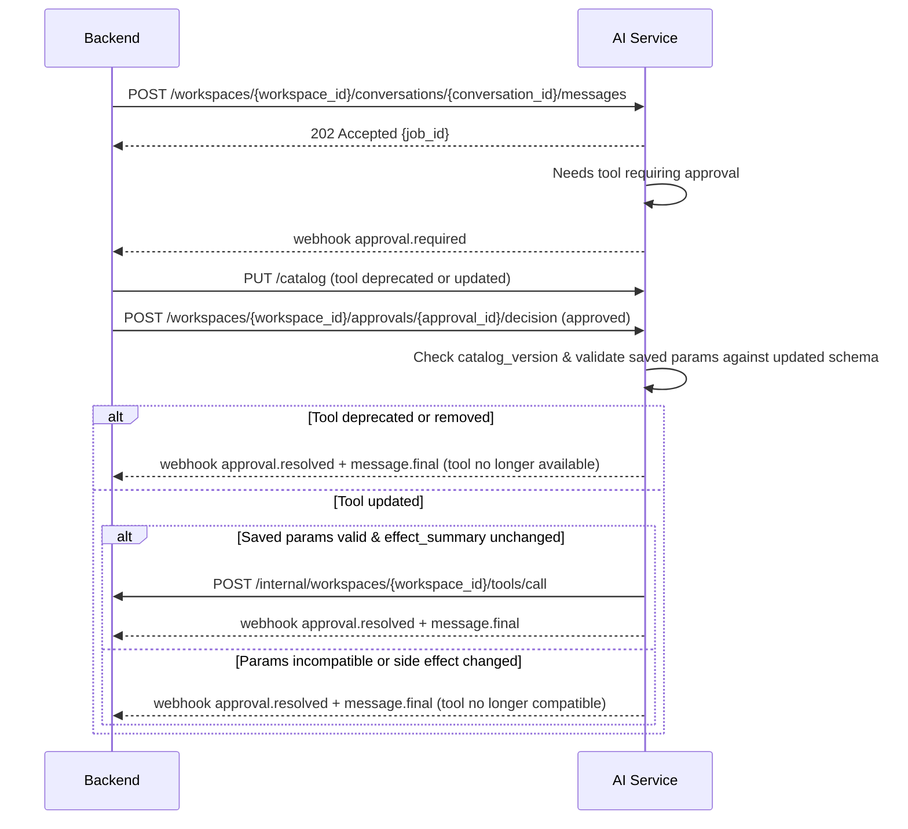

# Overview

> **Status:** Planned contract. No integration runtime is implemented in this repository unless source code proves otherwise.

**Call direction**

- **Backend API → AI Service:** incoming turn, approval decision, knowledge source add / retry / delete, catalog push, conversation mode.
- **AI Service → Backend API:** tool calls, catalog pull, webhooks.
- The AI Service returns results asynchronously via SSE events and webhooks ([§9](#9-events-and-webhooks)).
- The AI Service also calls Qdrant and LLM providers.
- The Backend owns tool execution, credentials, executions, the approval queue and history, and the conversations/messages tables.

## 1. System



The Backend owns PostgreSQL, the system catalog, agent configs (tool selection and approval flags), credentials, executions, the approval queue and history, and conversation messages. It sends the current `agent_config` with every request and executes every tool call.

The AI Service owns orchestration, retrieval, knowledge ingestion, and its own Postgres (LangGraph checkpoints, persistent jobs, events, idempotency ledger, catalog copy). Checkpoints hold agent state and message history for orchestration; they are separate from the Backend's conversations/messages tables, which serve frontend history. The AI Service keeps no agent config of its own and has no endpoint to create or read one.

## 2. Authentication

All internal requests use a bearer token over TLS. All workspace-scoped requests embed `{workspace_id}` directly in the URL path rather than using a header.

| Caller → receiver | Token |
| :--- | :--- |
| AI Service → Backend | `AI_IDENTITY_TOKEN` |
| Backend → AI Service | `BACKEND_IDENTITY_TOKEN` |

| Flow | Endpoint | Auth |
| :--- | :--- | :--- |
| Send a turn | `POST /workspaces/{workspace_id}/conversations/{conversation_id}/messages` (AI Service) | Backend token |
| Approval decision | `POST /workspaces/{workspace_id}/approvals/{approval_id}/decision` (AI Service) | Backend token |
| Add workspace knowledge source | `POST /workspaces/{workspace_id}/knowledge-sources` (AI Service) | Backend token |
| Source status | `GET /workspaces/{workspace_id}/knowledge-sources/{source_id}` (AI Service) | Backend token |
| Retry source | `POST /workspaces/{workspace_id}/knowledge-sources/{source_id}/retry` (AI Service) | Backend token |
| Delete source | `DELETE /workspaces/{workspace_id}/knowledge-sources/{source_id}` (AI Service) | Backend token |
| Push catalog | `PUT /catalog` (AI Service) | Backend token |
| Mode, events, trace, jobs | See [§8](#8-other-ai-service-endpoints) (AI Service) | Backend token |
| Call a tool | `POST /internal/workspaces/{workspace_id}/tools/call` (Backend) | AI token |
| Pull catalog | `GET /internal/catalog` (Backend) | AI token |
| Webhooks | `POST /webhooks/ai` (Backend) | AI token |

Provider credentials never leave the Backend. The AI Service is not notified when a workspace connects or disconnects an integration.

## 3. Incoming turn

The Backend stores the incoming message in its database and sends the new message and current `agent_config` to the AI Service. The AI Service loads prior messages and state from its checkpoint for `conversation_id`.

### 3.1 Context

```http
POST /workspaces/{workspace_id}/conversations/{conversation_id}/messages
Authorization: Bearer <BACKEND_IDENTITY_TOKEN>
Idempotency-Key: <key>
```

```jsonc
{
  "agent_id": 12,
  "channel_id": 42,
  "channel_type": "whatsapp",
  "content": "Where is my order?",
  "agent_config": {
    "catalog_version": 5,
    "name": "Customer Experience",
    "instructions": {
      "role": "Help customers resolve order questions.",
      "language_constraints": "Do not issue refunds without approval.",
      "locale": "en",
      "response_format": "Concise and friendly."
    },
    "tools": [
      { "tool_key": "vondera__get_product", "requires_approval": false },
      { "tool_key": "vondera__create_invoice", "requires_approval": true }
    ],
    "knowledge_source_ids": [101, 102]
  }
}
```

- `channel_id` is the workspace channel instance. `channel_type` is the code-defined transport type.
- `tools` is the agent's active, granted tool selection from connected integrations, paired with `requires_approval` flags resolved by the Backend from workspace policy. Descriptions, schemas, and definitions come from the catalog ([§7](#7-catalog)).
- `knowledge_source_ids` lists the workspace sources selected for the agent. Retrieval is limited to these IDs.
- `agent_config` applies to this turn only; the AI Service retains a copy for the duration of the run, and edits take effect on the next message.
- The AI Service narrows `tools` to those allowed for the agent's sub-agent. V1 has one sub-agent, `customer_support`, so `sub_agent_id` is omitted.
- The Backend rechecks grants and integration connection status at tool execution time.
- The AI Service persists the incoming message and turn state in its checkpoint; the Backend does not send prior messages.
- A repeated `Idempotency-Key` returns the existing job.
- `catalog_version` is the Backend's current catalog version. If the AI Service holds an older copy, it pulls the latest catalog before running ([§7](#7-catalog)).

**Response `202`:**

```jsonc
{ "job_id": "9f5c2e1a-..." }
```

### 3.2 Retrieval

The AI Service retrieves knowledge from Qdrant within `workspace_id` and limits results to the `knowledge_source_ids` selected for the agent. An empty list means no retrieval.

### 3.3 Tool decision

- If a selected tool is not permitted for the agent, the AI Service denies the call.
- If `requires_approval = false`, the AI Service calls `POST /internal/workspaces/{workspace_id}/tools/call`.
- If `requires_approval = true`, the AI Service pauses the run and sends the `approval.required` webhook ([§5.1](#51-approval-request)) without calling `tools/call`.

### 3.4 Turn result

The turn endpoint returns only `job_id`. The assistant response is delivered asynchronously ([§9](#9-events-and-webhooks)):

- `message.delta`: streamed tokens sent over SSE only for streaming-capable channels (not WhatsApp).
- `message.final`: the complete assistant message (`text`, `citations[]`) delivered via the `POST /webhooks/ai` webhook for all channels, including non-streaming channels and post-approval resumes ([§5.2](#52-decision-and-resume)), as well as SSE for active streams. The Backend stores it in its messages table and delivers it to the user.
- `job.completed` webhook: signals that the run has ended.

## 4. Tool calls

### 4.1 Request and response

**Caller:** AI Service → **Receiver:** Backend API

This is the transport behind the AI Service's `call_tool(integration_key, tool_key, args, idem_key)`.

```http
POST /internal/workspaces/{workspace_id}/tools/call
Authorization: Bearer <AI_IDENTITY_TOKEN>
```

```jsonc
{
  "agentId": 12,
  "conversationId": 456,
  "integrationKey": "vondera",
  "toolKey": "vondera__get_product",
  "arguments": { "productId": "prod_123" },
  "idempotencyKey": "sha256:6a0f..."
}
```

**Response `200` (Succeeded):**

```jsonc
{
  "data": {
    "execution": {
      "id": 9001,
      "status": "succeeded",
      "result": {}
    }
  }
}
```

**Response `200` (Failed):**

```jsonc
{
  "data": {
    "execution": {
      "id": 9001,
      "status": "failed",
      "error": {
        "code": "PROVIDER_ERROR",
        "message": "Provider returned 500",
        "retryable": true
      }
    }
  }
}
```

**Response `202` (Duplicate still running):**

```jsonc
{
  "data": {
    "execution": {
      "id": 9001,
      "status": "running"
    }
  }
}
```

### 4.2 Execution behavior

1. The Backend validates the agent, tool, and arguments.
2. It creates the execution record with `status = running`.
3. It fetches workspace credentials and rechecks the integration connection status.
4. It resolves the built-in handler from `toolKey`.
5. For transient errors, the Backend retries internally with backoff (capped at 3 retries) before returning a terminal failure.
6. On success, the Backend verifies the execution result internally by inspecting the provider response, stores `result`, sets `status = succeeded`, and records `finishedAt`.
7. A built-in `401` authentication error marks the connection `invalid`, sets `status = failed`, sets `finishedAt`, and returns `integration_not_connected`. Calling a disconnected integration returns the same error code.
8. Any other terminal failure sets `status = failed`, records `finishedAt`, and returns the error payload.

Execution creation, credential lookup, provider calls, retries, and response verification are all internal to the Backend.

### 4.3 Idempotency

The AI Service generates a unique `idempotencyKey` for every tool call (both side-effecting and read-only) and reuses it on network or timeout retries. The Backend treats the key as an opaque string under `UNIQUE (workspace_id, idempotency_key)`:

- **Side-effecting calls:** If an execution with the same key is `running`, return `202`. If terminal (`succeeded` or `failed`), return the stored result or error without calling the provider again.
- **Read-only calls:** Deduplicated only while `running` (returning `202` on client timeout retries to avoid duplicate concurrent provider calls). Once completed, read-only calls are never served from cached results and always run live.

### 4.4 Security

Provider calls execute exclusively in the Backend. The Backend enforces outbound request safety and does not follow redirects.

## 5. Approvals

### 5.1 Approval request

**Caller:** AI Service → **Receiver:** Backend API (webhook)

When a tool requires approval, the AI Service generates `approval_id` as a UUID ([§10](#10-identifier-generation-principle)), pauses the run, and sends the `approval.required` webhook ([§9](#9-events-and-webhooks)) to `POST /webhooks/ai`.

```jsonc
{
  "type": "approval.required",
  "workspace_id": 3,
  "agent_id": 12,
  "conversation_id": 456,
  "job_id": "9f5c2e1a-...",
  "data": {
    "approval_id": "550e8400-e29b-41d4-a716-446655440000",
    "tool_key": "quickbooks__send_invoice",
    "integration_key": "quickbooks",
    "params": { "customerId": "cus_123", "amount": 250 },
    "effect_summary": "Invoice of 250 will be sent to cus_123."
  }
}
```

The Backend stores the pending approval in its queue from this event without creating an execution. Because `approval_id` is generated upfront by the AI Service and webhooks are deduplicated by `event_id` and `approval_id`, webhook retries are safe and idempotent.

### 5.2 Decision and resume

A user approves or rejects the action via the client API. The Backend verifies the "Approve actions" permission and forwards the decision to the AI Service.

```http
POST /workspaces/{workspace_id}/approvals/{approval_id}/decision
Authorization: Bearer <BACKEND_IDENTITY_TOKEN>
```

```jsonc
{
  "decision": "approved | rejected",
  "approver_id": 77,
  "note": "optional",
  "agent_config": {
    /* current agent config, same shape as §3.1 */
  }
}
```

`approver_id` is the numeric Backend user ID that made the decision.

**Response `202`:**

```jsonc
{ "job_id": "c41d8a07-..." }
```

- **Approved:** The AI Service resumes from its checkpoint, validates the saved arguments, checks that the tool is still present in `agent_config.tools`, and verifies catalog compatibility against the current catalog ([§12](#12-catalog-synchronization--versioning-strategy)). If valid, it executes the tool via `tools/call` ([§4](#4-tool-calls)) and emits the final response.
- **Rejected:** The AI Service skips execution and informs the user that the action was stopped.
- **Unavailable or incompatible tool:** If the tool was deprecated, removed from `agent_config`, or its schema/side-effect changed incompatibly while pending, the AI Service skips execution and emits `message.final` stating the tool is no longer available.

In every outcome, the AI Service emits `approval.resolved`, sends `message.final` via webhook ([§3.4](#34-turn-result)), and completes the job.

## 6. Knowledge ingestion

### 6.1 Source model

All knowledge sources belong to the workspace. Agents select from this workspace library and do not create sources.

- **Content Hashing:** The Backend computes and stores a deterministic hash for every source:
  - `url`: hash of the normalized URL string (lowercased, trimmed, with tracking parameters such as `utm_*` stripped).
  - Files (`txt`, `pdf`, `docx`): cryptographic content hash, such as SHA-256.
- **Source Metadata:** User-provided `name` and `description` are stored on the workspace source.
- **Deduplication:** If identical content already exists in the workspace, the Backend rejects the request with `409 DUPLICATE_SOURCE` and does not ingest again or overwrite the existing source.
- **Assignment:** Agents are linked to selected source IDs. Assignment does not copy or re-ingest the source.
- **Deletion:** The Backend purges a source from Qdrant before removing its agent assignments and metadata. A purge failure keeps the source for retry.

### 6.2 Add a knowledge source

**Caller:** Backend → **Receiver:** AI Service

For a new source, the Backend inserts the record, generates `source_id` (database primary key, [§10](#10-identifier-generation-principle)), and dispatches the ingestion request.

```http
POST /workspaces/{workspace_id}/knowledge-sources
Authorization: Bearer <BACKEND_IDENTITY_TOKEN>
```

```jsonc
{
  "source_id": 101,
  "type": "url | txt | pdf | docx",
  "ref": "string",
  "name": "Company Policies",
  "description": "Internal company policies for customer support."
}
```

**Response `202`:**

```jsonc
{ "source_id": 101, "status": "processing" }
```

- `ref` is the target URL for `url` sources, or a short-lived presigned S3 URL for files (the AI Service holds no S3 credentials).
- Before returning `202`, the AI Service persists the ingestion job in a durable queue ([§11](#11-communication--queueing-approaches)) so work resumes automatically after crashes or restarts.
- The AI Service fetches, parses, chunks, embeds, and writes vectors to Qdrant scoped by `workspace_id` and `source_id`.



### 6.3 Status and retry

The AI Service reports ingestion progress via the `ingestion.status` webhook ([§9](#9-events-and-webhooks)). `GET /workspaces/{workspace_id}/knowledge-sources/{source_id}` returns the current state on demand:

```jsonc
{
  "status": "processing | ready | failed",
  "chunks": 42,
  "error": "string | null"
}
```

The webhook `data` carries `source_id`, `status`, `chunks`, and an error code (`fetch_failed` indicates an expired or unreachable URL).

```http
POST /workspaces/{workspace_id}/knowledge-sources/{source_id}/retry
```

```jsonc
{ "ref": "string | omitted" }
```

Returns `202`. The Backend owns the retry decision and supplies a fresh `ref` after a `fetch_failed` error.

### 6.4 Delete a knowledge source

**Caller:** Backend → **Receiver:** AI Service

```http
DELETE /workspaces/{workspace_id}/knowledge-sources/{source_id}
```

Returns `204`. The AI Service purges the source vectors from Qdrant. The Backend calls this endpoint before deleting local source metadata; a failed call keeps the source intact for retry.

## 7. Catalog

The system catalog is global and owned by the Backend. The AI Service maintains a read-only copy synchronized via push and pull ([§12](#12-catalog-synchronization--versioning-strategy)):

- **Push (CI/CD):** On Backend deployment, CI/CD pushes the catalog via `PUT /catalog` with `{ "catalog_version": 5, "tools": [...] }` using retries until acknowledged. The AI Service applies the update if `catalog_version` is newer and returns `{ "catalog_version": 5, "applied": true }`.
- **Pull (Startup & On-Demand):** The AI Service calls `GET /internal/catalog` on the Backend (`?full=true` returns tool definitions) at startup and whenever an incoming request carries a newer `agent_config.catalog_version`.
- **Tool fields:** `tool_key`, `integration_key`, `description`, input schema, side-effect class (`read-only` or `side-effecting`), `result_summary` and `effect_summary` templates, `version`, `deprecated`.
- The catalog contains no approval flags; approval flags are resolved from workspace policy and carried per agent and tool in `agent_config`.
- `tool_key` is immutable and never reused. Deprecated or disconnected tools are omitted from `agent_config.tools`.

## 8. Other AI Service endpoints

All carry `Authorization: Bearer <BACKEND_IDENTITY_TOKEN>`.

| Method | Path | Purpose |
| :--- | :--- | :--- |
| POST | `/workspaces/{workspace_id}/conversations/{conversation_id}/mode` | Body `{mode: human_control \| active \| closed}`. Returns `200`. |
| GET | `/workspaces/{workspace_id}/conversations/{conversation_id}/events` | SSE stream. Header `Last-Event-ID` replays missed events. |
| GET | `/workspaces/{workspace_id}/conversations/{conversation_id}/trace` | Ordered trace events for dev/admin monitoring. |
| GET | `/workspaces/{workspace_id}/jobs/{job_id}` | `{status: queued \| running \| waiting_approval \| done \| failed}`. |

- **Human handoff (`human_control`):** Once a conversation switches to `human_control` or `closed`, it remains under human control until the end of the conversation and does not return to the AI agent. The Backend stops forwarding messages to the AI Service once `human_control` or `closed` is set.
- The AI Service exposes no list endpoints; conversations, approval queues, and execution histories are Backend projections of AI events.

## 9. Events and webhooks

SSE (`/workspaces/{workspace_id}/conversations/{conversation_id}/events`) streams live events for active conversations.

Webhooks to `POST /webhooks/ai` deliver `message.final`, `job.completed`, `approval.required`, and `ingestion.status`.

**Envelope:**

```jsonc
{
  "event_id": "...",
  "seq": 12, // omitted for events unrelated to a conversation
  "ts": "...",
  "type": "...",
  "workspace_id": 3,
  "agent_id": 12, // omitted for workspace-level ingestion events
  "conversation_id": 456, // omitted for events unrelated to a conversation
  "job_id": "...",
  "data": {}
}
```

`seq` is monotonically increasing per conversation.

| Event | `data` keys |
| :--- | :--- |
| `plan.created` | `steps[]` |
| `retrieval.completed` | `sources[]`, `chunk_count` |
| `config.warning` | `code` (`unknown_tool` \| `tool_removed`), `tool_keys[]` |
| `approval.required` | `approval_id`, `tool_key`, `integration_key`, `params`, `effect_summary` |
| `approval.resolved` | `approval_id`, `decision`, `approver_id` |
| `handoff.requested` | `reason` |
| `message.delta` | `text` |
| `message.final` | `text`, `citations[]` |

`ingestion.status` and `job.completed` use the same envelope.

## 10. Identifier Generation Principle

To prevent duplicate records or orphaned vectors when network responses drop, the service that initiates an async workflow generates the unique ID before sending the request.

**Rule:** Whichever service starts an async workflow and waits on a result must generate the ID and pass it in the initial request.



- **Human Approvals ([§5](#5-approvals)):** The AI Service pauses its run to wait for a human decision, so it generates `approval_id` (UUID) before firing `approval.required`. Webhook retries reuse the same UUID and are deduplicated by primary key.
- **Knowledge Ingestion ([§6](#6-knowledge-ingestion)):** The Backend initiates ingestion when a source is added, so it generates `source_id` (database primary key) and passes it in the request. Retrying a dropped `202` response reuses the same ID without creating duplicate vectors in Qdrant.

## 11. Communication & Queueing Approaches

Async workflows in this contract, including incoming turns ([§3.1](#31-context)), human approvals ([§5](#5-approvals)), and knowledge ingestion ([§6](#6-knowledge-ingestion)), require durable persistence over point-to-point HTTP or volatile in-memory queues:

| Approach | Caller Latency | Crash Durability | Long Pauses & Load Spikes | Retry & Recovery | Complexity |
| :--- | :--- | :--- | :--- | :--- | :--- |
| **Point-to-Point (Sync HTTP)** | High (blocks until completion) | None (fails on disconnect or restart) | Poor (hits gateway timeouts; no buffering) | Manual (caller must hold state and retry) | Low |
| **Async (`202`) + In-Memory Queue** | Low (immediate response) | None (jobs in RAM are wiped on restart) | Limited (decoupled from HTTP timeout, bounded by RAM) | Volatile (pending retries vanish on crash) | Low |
| **Async (`202`) + Persistent Queue / Store** | Low (immediate response) | High (jobs saved to disk) | High (survives long pauses and buffers spikes safely) | Built-in (resumes and redelivers after restart) | Moderate |

- **Incoming Turns:** `202 Accepted` backed by persistent jobs and LangGraph checkpoints prevents gateway timeouts, survives restarts, and supports both SSE and webhook-only channels.
- **Human Approvals:** Persistent checkpoints and durable webhook delivery allow runs to pause safely for minutes or hours while waiting for a user decision without losing state on deployment or restart.
- **Knowledge Ingestion:** Persisting ingestion jobs before returning `202` decouples upload latency from parsing/embedding, absorbs bulk upload spikes, and resumes interrupted jobs after restarts.

## 12. Catalog Synchronization & Versioning Strategy

- **Push + Pull Catalog Sync:**
  - When Backend code deploys, CI/CD pushes the updated catalog via `PUT /catalog` with retry logic until the AI Service acknowledges it.
  - On startup (and on `catalog_version` mismatch), the AI Service pulls the catalog via `GET /internal/catalog` ([§2](#2-authentication)) so it stays synchronized even if a CI/CD push occurred during downtime.
- **Stateless Agent Configs:**
  - Because the Backend sends the latest `agent_config` on every turn ([§3.1](#31-context)) and approval decision ([§5.2](#52-decision-and-resume)), `config_version` is omitted from payloads and event envelopes.
- **Tool Changes During Pending Approvals ([§5.2](#52-decision-and-resume)):**
  - The AI Service stores only the latest catalog copy. When resuming an approved action after `catalog_version` has incremented, it validates the paused tool against the current catalog and `agent_config`:
    - If the tool was marked `deprecated` in the catalog or removed from `agent_config.tools`, the AI Service skips execution and emits `message.final` informing the user that the tool is no longer available.



## 13. Backend Ownership of Validation, Retries & Verification

Because the Backend owns `agent_config`, the tool catalog, credentials, and external provider calls, validation, transient retries, and execution verification reside in the Backend:

- **Agent Config Validation:** The Backend validates `agent_config` when an agent is created or updated, and the AI Service trusts incoming configs without a separate validation endpoint.
- **Tool Execution Retries ([§4.2](#42-execution-behavior)):** The Backend handles transient provider failures internally with backoff (up to 3 retries) before returning a terminal execution result.
- **Execution Verification ([§4.2](#42-execution-behavior)):** The AI Service does not verify write calls via separate read-only tool calls (since agents may lack read permissions, and some providers may lack read endpoints, while read verification only runs after a write already succeeded). Instead, the Backend verifies execution results internally by inspecting the provider response.

## 14. Future Work

- **Partial Channel Sender Data ([§3.1](#31-context)):** Sender metadata is not always available across all channels (e.g., WhatsApp or anonymous widget visitors). In future iterations, the Backend will pass whatever sender attributes are available per channel, and the AI Service will prompt users for missing details when required.
- **Approval Expiration (`expires_at`, [§5](#5-approvals)):** Expiration timestamps on approvals (`expires_at`), pre-expiry user notifications, and temporal expiry handling by the AI Service will be introduced in v2.
- **Dynamic Argument Re-Prompting on Tool Schema Updates ([§12](#12-catalog-synchronization--versioning-strategy)):** When a tool's input schema changes while an approval is pending, future versions will allow the AI Service to prompt the user for the updated arguments rather than failing compatibility.
- **Scheduled URL Re-Ingestion ([§6](#6-knowledge-ingestion)):** Periodic re-crawling and re-embedding when external website knowledge sources update their content.
- **Custom HTTP Actions:** User-defined HTTP action definitions, request templating, credentials, and generic execution are deferred.
- **Post-MVP Events & Webhooks ([§9](#9-events-and-webhooks)):** The following events are deferred past MVP:

| Event | `data` keys |
| :--- | :--- |
| `tool.started` | `call_id`, `tool_key`, `tool_version`, `integration_key`, `params_summary` |
| `tool.completed` | `call_id`, `status`, `result_summary`, `initiated_by` (`auto` \| member id) |
| `usage.recorded` | `tokens`, `cost`, `executions` |
| `error` | `code`, `retryable`, `message` |