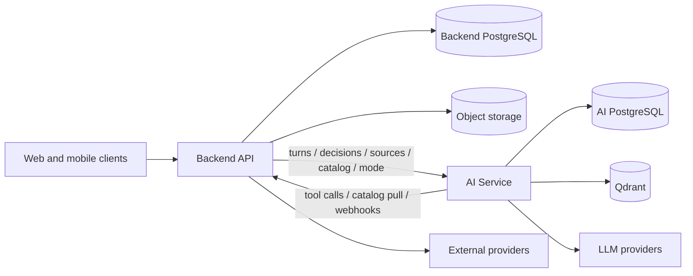

# System Architecture

> **Status:** Planned system design. Only `GET /api/v1/health` and the configuration scaffold are implemented.

FelOps has two independently deployed services: the Backend API and the AI Service. The Backend owns workspace data, credentials, approvals, and tool execution. The AI Service owns orchestration, checkpoints, retrieval, ingestion, and events.

## Designs

- [API design](api/api-design-outline.md)
- [Database design](database/database.md)
- [Database schema](database/schema.dbml)
- [AI Service contract](ai-service-integration/ai-service-contract.md)

## Components

| Component | Responsibility | Documentation |
| --- | --- | --- |
| Backend API | Client-facing API, workspace state, and tool execution. | [API design](api/api-design-outline.md) |
| AI Service | Orchestration, checkpoints, retrieval, ingestion, and events. | [AI Service contract](ai-service-integration/ai-service-contract.md) |
| Agents | Instructions, action grants, knowledge assignments, and approval requirements. | [Agents](features/agents.md) |
| Integrations and OAuth | Provider definitions, workspace connections, and connection state. | [Integrations](features/integrations.md) |
| Actions | Code-defined tools and workspace availability settings. | [Actions](features/actions.md) |
| Tool execution | Provider calls, retries, verification, and execution history. | [Actions](features/actions.md), [AI Service contract](ai-service-integration/ai-service-contract.md#4-tool-calls) |
| Knowledge | Workspace sources, ingestion, and agent source assignments. | [Knowledge](features/knowledge.md) |
| Approvals | Pending approvals, decisions, and approval history. | [Approvals](features/approvals.md) |
| Channels | Workspace channel instances and agent assignment. | [Channels](features/channels.md) |
| Conversations | Client conversation and message history. | [AI Service contract](ai-service-integration/ai-service-contract.md) |
| Backend PostgreSQL | Workspace, agent, connection, execution, and message state. | [Database design](database/database.md) |
| AI PostgreSQL | Checkpoints, durable jobs, events, and catalog copy. | [AI Service contract](ai-service-integration/ai-service-contract.md) |
| Object storage | Private knowledge files and ingestion references. | [Knowledge](features/knowledge.md) |
| Qdrant | Knowledge vectors. | [Knowledge](features/knowledge.md) |
| SSE and webhooks | Live client updates and AI Service event delivery. | [AI Service contract](ai-service-integration/ai-service-contract.md) |

## Decision records

- [ADR-0004: Backend-owned tool definitions and execution](adr/ADR-0004-backend-owned-tool-execution.md) (amended by ADR-0005 and ADR-0006)
- [ADR-0005: Async AI Service](adr/ADR-0005-async-ai-service-v3.md)
- [ADR-0006: Code-backed catalogs](adr/ADR-0006-code-backed-catalogs.md)
- [ADR-0007: OAuth provider integrations](adr/ADR-0007-oauth-provider-integrations.md)
- [ADR-0008: Multiple channel instances](adr/ADR-0008-multiple-channel-instances.md)
- [ADR-0009: Workspace action availability](adr/ADR-0009-workspace-action-availability.md)
- [ADR-0010: Workspace-only knowledge](adr/ADR-0010-workspace-only-knowledge.md)
