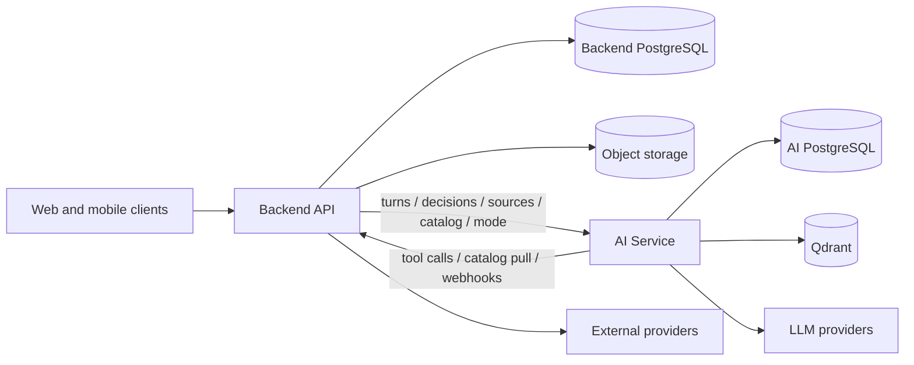

# System Architecture

> **Status:** Planned system design. Only `GET /api/v1/health` and the configuration scaffold are implemented.

FelOps has two independently deployed services: the Backend API and the AI Service.

Related design: [API outline](api/api-design-outline.md), [database schema](database/schema.dbml), and [AI Service contract v3](ai-service-integration/ai-service-contract.md).

Decision records: [ADR-0005](adr/ADR-0005-async-ai-service-v3.md), [ADR-0006](adr/ADR-0006-code-backed-catalogs.md), [ADR-0007](adr/ADR-0007-oauth-provider-integrations.md), [ADR-0008](adr/ADR-0008-multiple-channel-instances.md), [ADR-0009](adr/ADR-0009-workspace-action-availability.md), and [ADR-0010](adr/ADR-0010-workspace-only-knowledge.md).

## Services

| Service | Stack | Responsibility |
| --- | --- | --- |
| Backend | Express.js / TypeScript | Code integration, action, and channel registries; PostgreSQL; object storage uploads; agent configs; credentials; tool execution; executions; approval queue and history; conversation messages; client API |
| AI Service | FastAPI | Orchestration, LangGraph checkpoints, Qdrant retrieval, ingestion jobs, SSE/webhooks, catalog copy |

The Backend owns the source of truth for agents, integration and action definitions, channel type definitions, approvals, credentials, and frontend-visible conversations. The frontend owns the display catalog and localized labels for integrations, actions, and channel types. The AI Service owns its checkpoints, durable jobs, events, idempotency ledger, and catalog copy. It does not store agent configuration.

## Backend modules

| Module | Responsibility |
| --- | --- |
| Auth | Authentication and sessions. |
| Workspace | Membership, roles, settings. |
| [Agent](features/agents.md) | Instructions, action grants, selected workspace sources, resolved approval requirements. |
| [Integration](features/integrations.md) | Code integration catalog, OAuth lifecycle, workspace connections, credential health. |
| [Channel](features/channels.md) | Code channel type definitions, multiple workspace instances, single-agent assignment, opaque config. |
| [Actions](features/actions.md) | Code action catalog, workspace availability settings, grants, executions, retries, verification. |
| [Approvals](features/approvals.md) | Approval queue and history, client decision API, event projection. |
| Conversation | Conversation and message history for the frontend. |

Billing and client conversation APIs are outside this design set.

## OAuth provider profile

Each integration in the code registry defines:

| Field | Purpose |
| --- | --- |
| `authorization_url` | Provider consent page URL. |
| `token_url` | Authorization code and refresh token exchange URL. |
| `client_id_env` | Runtime environment variable name for the OAuth client ID. |
| `client_secret_env` | Runtime environment variable name for the OAuth client secret. |
| `scopes` | Scopes requested during authorization. |
| `authorization_params` | Optional provider parameters such as audience or prompt. |
| `account_discovery_url` | Endpoint that lists accounts available to the token. |
| `account_id_field` | Response field used as the external account ID. |
| `account_name_field` | Response field used as the external account display name. |
| `account_url_field` | Optional response field used as the external account URL. |
| `api_base_url` | Provider API base URL template for tool calls. |
| `refresh_token_rotation` | Whether refresh tokens are replaced on refresh. |
| `token_endpoint_auth_method` | Client secret transport expected by the token endpoint. |

The callback URL must exactly match the redirect URI registered with the provider. Client credentials stay in Backend runtime configuration. Provider OAuth configuration and client credentials never appear in frontend code or database rows. Adding a provider requires a registry entry and adapter; the OAuth state, callback, storage, and token refresh flow stay the same.

## AI Service

- Orchestrates each turn from its LangGraph checkpoint.
- Retrieves from Qdrant within the workspace, limited to the agent's selected knowledge source IDs.
- Owns ingestion jobs and reports status through webhooks.
- Pauses for approvals, generates approval UUIDs, and resumes on decision.
- Maintains a read-only catalog copy synchronized by push/pull.
- Never receives provider credentials.

## Tool execution

When the AI Service calls `POST /internal/workspaces/{workspace_id}/tools/call`:

1. The Backend validates the agent, tool, workspace availability, and arguments.
2. It creates an execution with `status = running`.
3. It fetches integration credentials and rechecks the connection.
4. It resolves the built-in handler from `toolKey`.
5. Transient provider failures are retried internally with backoff, up to three retries.
6. On success, the Backend verifies the provider response, stores `result`, and marks the execution `succeeded`.
7. A built-in `401` marks the connection `invalid` and returns `integration_not_connected`; the execution is `failed`.
8. Any other terminal failure marks the execution `failed` with an error payload containing `code`, `message`, and `retryable`.

Execution creation, credential lookup, provider calls, retries, and response verification stay inside the Backend.

## Catalog and idempotency

- The system catalog is a code registry keyed by stable tool key. The database does not store built-in action definitions. The AI Service keeps a read-only copy.
- The catalog version comes from the registry build or content hash, not a database row.
- CI/CD pushes the catalog to the AI Service with `PUT /catalog`.
- The AI Service pulls the catalog with `GET /internal/catalog` on startup or when its catalog version is older.
- Catalog tool fields include tool key, integration key (`integrationKey`), LLM-facing description, input schema, side-effect class, summaries, version, and deprecation.
- Approval requirements live in `agent_config` as `requires_approval`, not in the catalog.
- Every execution stores a unique `(workspace_id, idempotency_key)`.
- Side-effecting calls deduplicate across running and terminal states.
- Read-only calls deduplicate only while running; completed reads always run live.

## Domain concepts

- **Integrations:** code-defined external systems with OAuth connections and workspace connection state.
- **Actions:** code-defined catalog tools; agents receive database-backed grants and resolved approval requirements.
- **Knowledge:** workspace sources selected by agents, ingested into Qdrant.
- **Agents:** instructions, action grants, selected workspace sources, resolved approval requirements.
- **Channels:** workspace deployment instances; multiple instances per type, each with at most one agent.
- **Approvals:** AI-generated requests for gated tools; the Backend stores the approvals.
- **Executions:** Backend-owned provider calls triggered by AI `tools/call`.

## Async behavior

- Turns and approval decisions return `202` with a job ID. Knowledge ingestion returns `202` with a source ID.
- The AI Service sends `message.final`, `job.completed`, `approval.required`, and `ingestion.status` to `POST /webhooks/ai`.
- SSE streams `message.delta` and other live events for active conversations.

## Platform components

| Component | Purpose |
| --- | --- |
| Code registries | Integration definitions including OAuth settings, action definitions and handlers, channel type definitions. |
| Backend PostgreSQL | Users, workspaces, agents, channels, workspace integration connections and OAuth state, workspace action settings, action grants, knowledge metadata, conversations, messages, executions, approvals. |
| Object storage | Private knowledge files and presigned ingestion references. |
| AI PostgreSQL | LangGraph checkpoints, durable jobs, events, idempotency ledger, catalog copy. |
| Qdrant | Knowledge vectors. |
| Redis | Planned cache; not part of the current AI contract. |
| SSE | Real-time client and conversation updates. |
