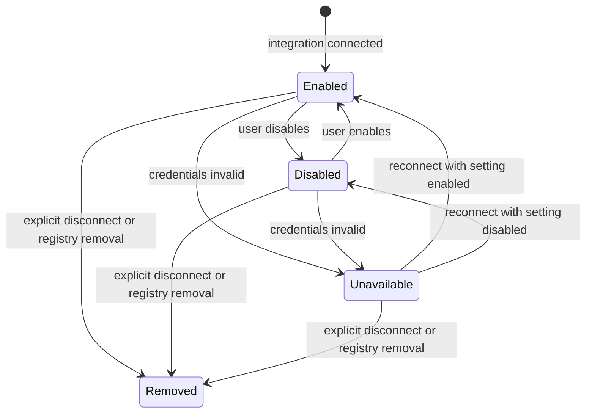

# Actions

Actions are code-defined catalog tools that agents can request, with workspace availability controls.

> **Status:** Planned design. No API behavior is implemented unless source code proves otherwise.

Connection state is owned by [Integrations](integrations.md); agent grants are configured in [Agents](agents.md).

## 1. Workflows

### Browse the action catalog

- **Where:** Actions page.
- **Flow:**
  1. The frontend sends `GET /workspaces/{workspace_id}/actions?page=1&limit=20&search=&integration_key=&availability=`.
  2. The Backend returns a paginated list with tool keys, integration keys, read/write type, availability, assigned-agent counts, and the catalog version, plus aggregate action stats: `Enabled`, `Disabled`, and `Unavailable`.
  3. The frontend renders localized action names, descriptions, and integration labels.
  4. Search and filters narrow the list by integration and category.
  5. Selecting a row opens the action detail.
- **Rules:**
  - The list includes all workspace actions from connected integrations, including invalid connections.
  - Actions from integrations the workspace has never connected are not listed.
  - `Enabled` means the connection is healthy and no workspace override disables the action.
  - `Disabled` means the user disabled the action for this workspace.
  - `Unavailable` means the integration connection is invalid and must be reconnected.

### Inspect an action

- **Where:** Action detail.
- **Flow:**
  1. The frontend sends `GET /workspaces/{workspace_id}/actions/{tool_key}`.
  2. The Backend returns read/write type, availability, the workspace setting, and assigned agents.
  3. The frontend localizes the action and integration keys.
  4. The frontend allows availability changes only when the connection is healthy.

### Set workspace action availability

- **Where:** Action detail.
- **Flow:**
  1. The user enables or disables the action for this workspace.
  2. The frontend sends `PUT /workspaces/{workspace_id}/actions/{tool_key}/availability` with `enabled` set to `true` or `false`.
  3. The Backend verifies the workspace, action, and integration connection.
  4. It creates or updates the workspace action setting.
- **Errors:**
  - `404 NOT_FOUND`: the workspace or action does not exist.
  - `409 ACTION_UNAVAILABLE`: the integration must be reconnected before the action can be enabled.
  - `422 VALIDATION_ERROR`: the `enabled` value is invalid.

### Review execution history

- **Where:** Actions page or Agent detail.
- **Flow:**
  1. The frontend sends `GET /workspaces/{workspace_id}/executions?page=1&limit=20&status=` for the workspace view or `GET /workspaces/{workspace_id}/agents/{agent_id}/executions?page=1&limit=20&status=` for Agent detail.
  2. The Backend returns a paginated list of execution records ordered by `createdAt` descending.
  3. The frontend shows action, integration, agent, conversation, status, error, and timing.

## 2. Workspace availability

Workspace action settings are stored only when they differ from the default. No row means enabled by default.

- Invalid credentials do not delete settings or agent grants. They make the actions `Unavailable`.
- Removing an action from the code registry removes its settings and grants.
- Only enabled actions from connected integrations can be assigned to an agent.
- The Backend preserves stored grants for disabled or unavailable actions. They stay locked and are omitted from `agent_config`.
- Approval requirements come from workspace policy; assignment workflows do not edit approval flags.

## 3. Future work

- Custom HTTP actions: user-defined URL, method, variables, headers, body, test request, and lifecycle.

## 4. Decisions

- Built-in action definitions and handlers live in code. Database rows represent workspace settings, grants, and executions only.
- The Backend updates workspace action availability to `Unavailable` when a provider call fails due to invalid credentials.
- The Backend owns the catalog registry, tool execution, credentials, and execution history.
- Built-in handlers are selected by tool key in code.
- The Backend verifies provider responses before storing execution results.
- Action descriptions in the code registry are LLM-facing only. Frontend localization owns user-facing action names and descriptions.
