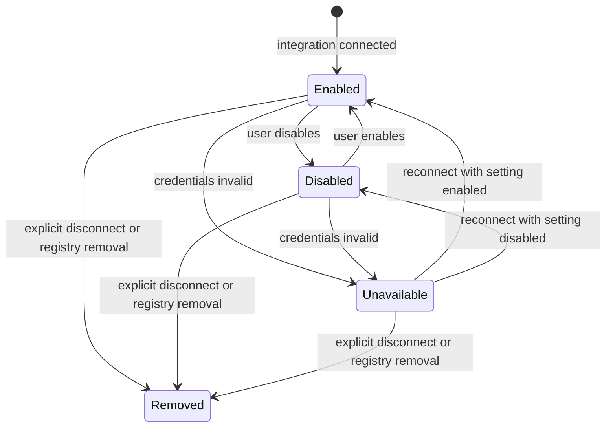

# Actions

Actions are catalog tools exposed to agents. Built-in action definitions live in the Backend code registry. The database stores workspace availability settings, agent grants, and execution history. The Backend also owns resolved approval requirements, credentials, and provider execution. The frontend maps each `tool_key` and `integration_key` to localized action and integration labels. The AI Service receives only the current agent tool selection and calls the Backend to execute a tool.

## 1. Workflows

### Browse the action catalog

- **Where:** Integrations & Actions page, Actions tab.
- **Endpoint:** `GET /workspaces/{workspace_id}/actions`
- **Flow:**
  1. The frontend loads action stats: Enabled, Disabled, and Unavailable.
  2. The API returns tool keys, integration keys, read/write type, availability, assigned-agent counts, and the catalog version.
  3. The frontend renders localized action names, descriptions, and integration labels.
  4. Search and filters narrow the list by integration and category.
  5. Selecting a row opens the action detail.
- **Outcome:** The action catalog and availability stats render.
- **Rules:**
  - The list includes actions for workspace integrations with a connection record, including invalid connections.
  - Actions from integrations the workspace has never connected are not listed.
  - `Enabled` means the registry action is active, the connection is healthy, and no workspace override disables it.
  - `Disabled` means the user disabled the action for this workspace.
  - `Unavailable` means the integration connection is invalid and must be reconnected.
  - Registry-disabled actions are hidden.
  - If no actions are available, the page links to the Integrations tab to connect an integration.
  - If the frontend receives an unknown tool key, show the key and an update-required message. Do not crash, hide the row, or silently remove an existing grant.
  - Block new assignment of an unknown tool until the frontend localization is updated. Existing grants remain visible and unchanged.
  - Release checks should verify that every active built-in tool key has a frontend localization entry.

### Inspect an action

- **Where:** Actions tab, action row.
- **Endpoint:** `GET /workspaces/{workspace_id}/actions/{tool_key}`
- **Flow:**
  1. The frontend maps `tool_key` to a localized action name and user-facing description, and `integration_key` to the localized integration.
  2. The API supplies read/write type, availability, the workspace availability setting, and assigned agents. The LLM-facing action description is not used for display.
  3. Availability maps to `Enabled`, `Disabled`, or `Unavailable`.
  4. The Availability toggle is editable only when the connection is healthy.
- **Outcome:** The action detail renders with its workspace availability control.

### Set workspace action availability

- **Where:** Action detail, Availability toggle.
- **Endpoint:** `PUT /workspaces/{workspace_id}/actions/{tool_key}/availability`
- **Flow:**
  1. The user enables or disables the action for this workspace.
  2. The Backend verifies the workspace, action, and integration connection.
  3. It creates or updates the workspace action setting.
  4. Existing agent grants are kept when the action is disabled.
  5. The next `agent_config` omits a disabled or unavailable tool.
- **Outcome:** The action is `Enabled` or `Disabled`. An invalid connection keeps it `Unavailable`. An explicit disconnect removes the action, its workspace setting, and agent grants.
- **Errors:**
  - `404 NOT_FOUND`: the workspace or action does not exist.
  - `409 ACTION_UNAVAILABLE`: the integration must be reconnected before the action can be enabled.
  - `422 VALIDATION_ERROR`: the `enabled` value is invalid.

### Configure agent actions

- **Where:** Agent creation, Assign Actions; Agent detail, Assigned Actions, `Edit assignments`.
- **Endpoints:**
  - `GET /workspaces/{workspace_id}/agents/{agent_id}/actions`
  - `PUT /workspaces/{workspace_id}/agents/{agent_id}/actions`
- **Flow:**
  1. The picker loads available Workspace Actions and the current grants.
  2. The user selects the actions the agent may request; unavailable actions are disabled.
  3. Saving replaces the editable grants and preserves stored grants for disabled or unavailable actions.
- **Outcome:** The agent's action grants are stored. Approval requirements are resolved from workspace policy into those grants.
- **Rules:**
  - Only workspace-enabled actions from connected integrations can be granted or changed.
  - A grant for a disabled or unavailable action is kept but cannot be changed until the action becomes available again.
  - Approval requirements are resolved from workspace policy; this picker does not edit approval flags.
  - A disabled or unavailable grant is omitted from the next turn's `agent_config`.
  - If no Workspace Actions are available, the picker shows an empty state that links to the Integrations tab.
  - The AI Service receives the latest enabled tool grants in every turn's `agent_config`.

### Review execution history

- **Where:** Integrations & Actions page, Actions tab, execution history; Agent detail, execution history.
- **Endpoints:**
  - `GET /workspaces/{workspace_id}/executions`
  - `GET /workspaces/{workspace_id}/agents/{agent_id}/executions`
- **Flow:**
  1. The Backend returns execution records ordered by `createdAt` descending.
  2. The UI shows action, integration, agent, conversation, status, error, and timing.
- **Outcome:** The execution table renders.

## 2. Workspace availability

Workspace action settings are sparse overrides. No row means enabled by default.

- The list is scoped to integrations with a workspace connection record.
- Actions from integrations that were never connected are not listed.
- Invalid credentials do not delete settings or agent grants. They make the actions `Unavailable`.
- Explicit disconnect removes workspace action settings and agent grants for that integration.
- Removing an action from the code registry removes its settings and grants.

## 3. Tool execution

When the AI Service calls `POST /internal/workspaces/{workspace_id}/tools/call`:

1. The Backend validates the agent, tool, workspace availability, and arguments.
2. It creates an execution with `status = running`.
3. It fetches integration credentials and rechecks the connection.
4. It resolves the built-in handler from `toolKey`.
5. Transient provider failures are retried internally with backoff, up to three retries.
6. On success, the Backend verifies the provider response, stores `result`, and marks the execution `succeeded`.
7. A built-in `401` marks the connection `invalid` and returns `integration_not_connected`; the execution is `failed`.
8. Any other terminal failure marks the execution `failed` with an error payload containing `code`, `message`, and `retryable`.

Execution creation, credential lookup, provider calls, retries, and response verification stay inside the Backend.

## 4. Catalog and idempotency

- The system catalog is a code registry keyed by stable tool key. The database does not store built-in action definitions. The AI Service keeps a read-only copy.
- The catalog version comes from the registry build or content hash, not a database row.
- CI/CD pushes the catalog to the AI Service with `PUT /catalog`.
- The AI Service pulls the catalog with `GET /internal/catalog` on startup or when its catalog version is older.
- Catalog tool fields include tool key, integration key (`integrationKey`), LLM-facing description, input schema, side-effect class, summaries, version, and deprecation.
- Approval requirements live in `agent_config` as `requires_approval`, not in the catalog.
- Every execution stores a unique `(workspace_id, idempotency_key)`.
- Side-effecting calls deduplicate across running and terminal states.
- Read-only calls deduplicate only while running; completed reads always run live.

## 5. Future work

- Custom HTTP actions: user-defined URL, method, variables, headers, body, test request, and lifecycle.

## 6. Decisions

- Built-in action definitions and handlers live in code. Database rows represent workspace settings, grants, and executions only.
- Workspace action settings are overrides, the no row default means enabled.
- Disabling an action keeps agent grants but omits the tool from `agent_config`.
- Invalid integration credentials keep settings and grants and make actions unavailable.
- Explicit integration disconnect removes workspace action settings and agent grants for that integration.
- The Backend checks workspace action availability again when executing a tool.
- The Backend owns the catalog registry, tool execution, credentials, and execution history.
- Built-in handlers resolve through the code-level tool-key map.
- Provider calls are verified in the Backend from the provider response.
- Execution results are stored for side-effect idempotency.
- Custom actions, when added later, use a separate database-backed definition table and generic HTTP handler.
- Action descriptions in the code registry are LLM-facing only. Frontend localization owns user-facing action names and descriptions.
