# Approvals

Approvals gate actions that workspace policy flags for review before execution.

> **Status:** Planned design. No API behavior is implemented unless source code proves otherwise.

Approval requirements originate from workspace policy and agent grants in [Actions](actions.md) and [Agents](agents.md).

## 1. Workflows

### Browse pending approvals

- **Where:** Agent detail, Pending approvals.
- **Flow:**
  1. The frontend sends `GET /workspaces/{workspace_id}/agents/{agent_id}/approvals?status=pending&page=1&limit=20` and loads paginated pending approvals for the agent.
  2. The Backend returns approvals with `status = pending`, no decider, and no decision time.
  3. The frontend localizes the action and integration keys.
  4. The frontend shows the conversation, effect summary, and decision options.
  5. Pending approvals render, ordered by `requestedAt` descending.

### Browse approval history

- **Where:** Agent detail, Approval history.
- **Flow:**
  1. The frontend sends `GET /workspaces/{workspace_id}/agents/{agent_id}/approvals?status=decided&page=1&limit=20`.
  2. The Backend returns a paginated list of approvals with `status = approved` or `rejected`.
  3. The frontend shows the decision, decider, and decision time.
  4. Approval history renders newest first.

### Create a pending approval

- **Where:** `approval.required` webhook from the AI Service.
- **Flow:**
  1. The AI Service generates an approval UUID and pauses the run.
  2. It sends `approval.required` to `POST /webhooks/ai` with agent, conversation, job, `tool_key`, `integration_key`, params, and effect summary.
  3. The Backend stores the approval as `pending`.
  4. No execution is created.

### Approve or reject

- **Where:** Agent detail, Approvals.
- **Flow:**
  1. The user submits `approved` or `rejected`, with an optional note.
  2. The frontend sends `POST /workspaces/{workspace_id}/approvals/{approval_id}/decision`.
  3. The Backend forwards `POST /workspaces/{workspace_id}/approvals/{approval_id}/decision` to the AI Service with `decision`, `approver_id`, optional `note`, and current `agent_config`.
  4. The AI Service returns `202` with a `job_id`.
  5. If approved, the AI Service calls `POST /internal/workspaces/{workspace_id}/tools/call`.
  6. If rejected, it skips execution and informs the user.
  7. The AI Service emits `approval.resolved` and sends the `message.final` webhook.
  8. The Backend stores the message.
- **Errors:**
  - `404 NOT_FOUND`: the workspace or approval does not exist.
  - `409 ALREADY_DECIDED`: the approval already has a decision.
  - `422 VALIDATION_ERROR`: the decision is missing or invalid.
  - `503 UPSTREAM_UNAVAILABLE`: the AI Service did not accept the decision.

## 2. Approval state

```mermaid
stateDiagram-v2
  state "Pending: waiting for a member decision; the run is paused" as Pending
  state "Approved: AI may resume and execute if still compatible" as Approved
  state "Rejected: AI resumes without executing" as Rejected

  [*] --> Pending: approval.required
  Pending --> Approved: user approves
  Pending --> Rejected: user rejects
  Approved --> [*]: AI validates and may call tools/call
  Rejected --> [*]: final message without execution
```

- Approvals do not expire in the MVP.
- The AI Service revalidates the saved arguments, the current `agent_config.tools`, and the catalog before execution; if the tool is unavailable, it emits a message explaining that.
- The Backend does not create or own the execution at decision time; execution begins only when the AI Service calls `tools/call`.

## 3. Future work

- Approval expiry and reminders.
- Role-based approval authority.

## 4. Decisions

- Pending, approved, and rejected approvals share one table; the queue is the pending rows.