# Approvals

Approvals gate actions whose workspace policy requires approval. Policy configuration is outside this design set. The Backend evaluates that policy when it builds each `agent_config`, including the config sent with an approval decision, and stores the resolved `requiresApproval` grant. The AI Service pauses before `tools/call` when the flag is set. The AI Service owns the paused run and the approval ID; the Backend owns the approval queue, UI, and decision forwarding.

> **Status:** Planned design. No API behavior is implemented unless source code proves otherwise.

Approval requirements originate from workspace policy and agent grants in [Actions](actions.md) and [Agents](agents.md).

## 1. Workflows

### Browse pending approvals

- **Where:** Agent detail, Approvals tab, Pending.
- **Endpoint:** `GET /workspaces/{workspace_id}/agents/{agent_id}/approvals?status=pending&page=1&limit=20`
- **Flow:**
  1. The frontend loads paginated pending approvals for the agent.
  2. The Backend returns approvals with `status = pending`, no decider, and no decision time.
  3. The UI maps the stored tool and integration keys to localized action and integration labels, then shows the conversation, effect summary, and `Approve`/`Reject`.
- **Outcome:** Pending approvals render, ordered by `requestedAt` descending.
- **Rules:**
  - Paginated with the shared defaults and maximum.

### Browse approval history

- **Where:** Agent detail, Approvals tab, History.
- **Endpoint:** `GET /workspaces/{workspace_id}/agents/{agent_id}/approvals?status=decided&page=1&limit=20`
- **Flow:**
  1. The Backend returns a paginated list of approvals with `status = approved` or `rejected`.
  2. The UI shows the decision, decider, and decision time.
- **Outcome:** Approval history renders newest first.
- **Rules:**
  - Paginated with the shared defaults and maximum.

### Create a pending approval

- **Where:** `approval.required` webhook from the AI Service.
- **Endpoint:** `POST /webhooks/ai`
- **Flow:**
  1. The AI Service generates an approval UUID, pauses the run, and sends `approval.required` with agent, conversation, job, `tool_key`, `integration_key`, params, params hash, and effect summary.
  2. The Backend stores the approval as `pending`.
  3. No execution is created.
  4. Webhook retries are deduplicated by `event_id` and `approval_id`.
- **Outcome:** The approval appears in the queue.

### Approve or reject

- **Where:** Agent detail, Approvals tab.
- **Endpoint:** `POST /workspaces/{workspace_id}/approvals/{approval_id}/decision`
- **AI handoff:** `POST /workspaces/{workspace_id}/approvals/{approval_id}/decision` with `decision`, `approver_id`, optional `note`, and current `agent_config`.
- **Flow:**
  1. The user submits `approved` or `rejected`, with an optional note.
  2. The Backend verifies the "Approve actions" permission and forwards the decision with the current `agent_config`.
  3. The AI Service returns `202` with a `job_id`.
  4. If approved, the AI Service validates `params_hash`, checks that the tool is still in `agent_config.tools`, verifies catalog compatibility, and calls `POST /internal/workspaces/{workspace_id}/tools/call`.
  5. If rejected, the AI Service skips execution and informs the user.
  6. The AI Service emits `approval.resolved` and sends the `message.final` webhook; the Backend stores the assistant message.
- **Outcome:** The approval is decided; execution may follow only for approved decisions.
- **Errors:**
  - `404 NOT_FOUND`: the workspace or approval does not exist.
  - `409 ALREADY_DECIDED`: the approval already has a decision.
  - `422 VALIDATION_ERROR`: the decision is missing or invalid.
  - `503 UPSTREAM_UNAVAILABLE`: the AI Service did not accept the decision.

## 2. Approval state

```mermaid
stateDiagram-v2
  state "Pending: waiting for a member decision; the run is paused" as Pending
  state "Approved: AI may resume and execute if still compatible" as Approved
  state "Rejected: AI resumes without executing" as Rejected

  [*] --> Pending: approval.required
  Pending --> Approved: user approves
  Pending --> Rejected: user rejects
  Approved --> [*]: AI validates and may call tools/call
  Rejected --> [*]: final message without execution
```

- The approval ID is a UUID generated by the AI Service.
- The Backend stores `tool_key`, `integration_key`, params, `params_hash`, effect summary, conversation, and job ID.
- Approvals do not expire in the MVP.
- The AI Service revalidates `params_hash`, the current `agent_config.tools`, the arguments, and the catalog before execution; if the tool is unavailable, it emits a message explaining that.
- The Backend does not create or own the execution at decision time; execution begins only when the AI Service calls `tools/call`.

## 3. Future work

- Approval expiry and reminders.
- Workspace-wide approvals view.
- Bulk decisions.
- Role-based approval authority.
- Dynamic argument re-prompting when a tool schema changes.

## 4. Decisions

- The AI Service owns paused run state and approval IDs.
- The Backend owns the approval queue and decision UI.
- Pending approvals do not create executions.
- Approval decisions carry the current `agent_config`, just like turns.
- Approved tools execute through the normal AI → Backend `tools/call` path.
- Rejected approvals skip execution and still produce an assistant message.
