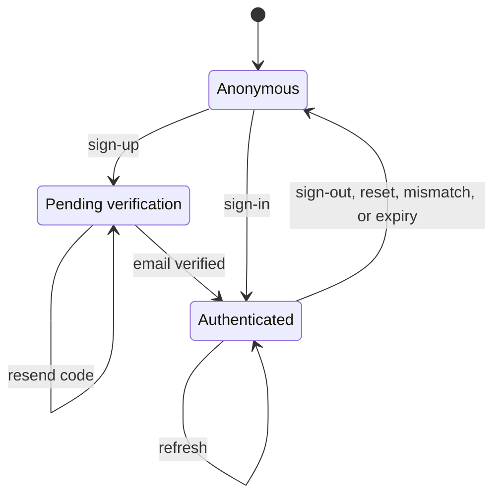

# Authentication

Authentication creates Backend accounts, verifies email addresses, and manages user sessions with email and password credentials.

> **Status:** Implemented in `api/src/modules/auth/` (10 endpoints + bearer `authenticate` middleware). See [project-context.md](../project-context.md) for verified runtime state.

The [API outline](../api/api-design-outline.md) owns the auth endpoints, error codes, and OpenAPI notes. The [database guide](../database/database.md) explains session and auth-code modeling; [schema.dbml](../database/schema.dbml) holds the canonical definitions. Workspace access and membership are out of scope for this page; non-members receive `404 NOT_FOUND` on workspace resources per the API outline.

## 1. Workflows

### Create account

- **Where:** Create Account screen.
- **Flow:**
  1. The user submits a name, email, and password.
  2. The frontend sends `POST /api/v1/auth/sign-up` with `{ name, email, password }`.
  3. The Backend validates the fields (including the 12-character password minimum) and normalizes the email to lowercase.
  4. For a new email, the Backend creates an unverified user, creates a verification code, and sends the verification email.
  5. For an existing unverified email, the Backend leaves the existing name and password unchanged, invalidates prior verification codes, creates a new code, and sends the verification email.
  6. For an existing verified email, the Backend leaves the account unchanged and returns `409 EMAIL_ALREADY_EXISTS` so the frontend routes the user to sign in.
  7. Newly created or existing unverified accounts return empty `202 Accepted`.
  8. No session is created before verification.
- **Errors:**
  - `409 EMAIL_ALREADY_EXISTS`: a verified account already exists for this email.
  - `422 VALIDATION_ERROR`: a field is missing or invalid (including password shorter than 12 characters).
  - `429 RATE_LIMITED`: the sign-up rate limit is exceeded.
  - `503 UPSTREAM_UNAVAILABLE`: the verification email could not be sent (`details: [{ service: "email" }]`); retry the request.

### Verify email

- **Where:** Check your email and the verification-code entry.
- **Flow:**
  1. The frontend sends `POST /api/v1/auth/verify-email` with `{ email, code }`.
  2. The Backend hashes the submitted code and validates the hash before checking expiry, attempt count, and single use.
  3. The Backend sets `is_verified = true`, consumes the code, and creates a session.
  4. The Backend returns `200` with an access token and the user, and sets the refresh cookie.
  5. A resend request uses `POST /api/v1/auth/resend-verification` with `{ email }`.
  6. For an unverified account, the Backend invalidates the previous code, sends a new code, and returns empty `202`. Unknown emails return `404 NOT_FOUND` (`details: [{ resource: "user" }]`) and verified emails return `409 EMAIL_ALREADY_VERIFIED`. Requests over the route rate limit return `429 RATE_LIMITED`.
- **Errors:**
  - `404 NOT_FOUND`: no account exists for the submitted email on resend (`details: [{ resource: "user" }]`).
  - `409 EMAIL_ALREADY_VERIFIED`: the account's email is already verified on resend.
  - `422 INVALID_VERIFICATION_CODE`: the code is wrong, exhausted, consumed, or unknown.
  - `422 VERIFICATION_CODE_EXPIRED`: a matching code has expired.
  - `429 RATE_LIMITED`: the resend rate limit is exceeded.
  - `503 UPSTREAM_UNAVAILABLE`: the verification email could not be sent (`details: [{ service: "email" }]`); retry the request.
- **Rules:**
  - Verification codes are 6 digits, hashed with HMAC-SHA-256 and a server pepper, with a 10-minute expiry.
  - A code allows 5 attempts and is single-use.
  - Resend requests are rate-limited per client IP by the route middleware.

### Sign in

- **Where:** Sign in screen.
- **Flow:**
  1. The frontend sends `POST /api/v1/auth/sign-in` with `{ email, password }`.
  2. The Backend verifies the credentials against the Argon2id password hash.
  3. A wrong email or password returns a generic `401 INVALID_CREDENTIALS`.
  4. Correct credentials for an unverified email return `403 EMAIL_NOT_VERIFIED`; the frontend offers resend.
  5. A successful sign-in creates a session, returns `200` with an access token and the user, and sets the refresh cookie.
- **Errors:**
  - `401 INVALID_CREDENTIALS`: the email or password is wrong.
  - `403 EMAIL_NOT_VERIFIED`: the email address is not verified.
  - `429 RATE_LIMITED`: the sign-in rate limit is exceeded.

### Refresh session

- **Where:** Any authenticated request after the access token expires.
- **Flow:**
  1. The frontend sends `POST /api/v1/auth/refresh` with the refresh cookie.
  2. The Backend verifies the hashed refresh token, rotates it, and returns a new access token and the user.
  3. The response sets the new refresh cookie.
  4. A missing, invalid, or revoked token returns `401 SESSION_EXPIRED`.
  5. A token mismatch outside a brief grace window for concurrent refreshes revokes the session.
- **Errors:**
  - `401 SESSION_EXPIRED`: the session is missing, expired, revoked, or mismatched.
- **Rules:**
  - The refresh token is an opaque `<session_id>.<secret>` value. Only the secret hash is stored, so a stale token still identifies its session and a mismatch outside the grace window revokes that session.
  - The refresh cookie uses `SameSite=None; Secure` for cross-site frontends (`Lax` over local HTTP). Refresh and sign-out reject Origins outside `CORS_ORIGINS` with `403 FORBIDDEN`.

### Get current user

- **Where:** Any authenticated screen that needs the current user profile from an active access token.
- **Flow:**
  1. The frontend sends `GET /api/v1/auth/me` with `Authorization: Bearer <accessToken>`.
  2. The Backend verifies the access token, loads the user by ID, and returns `200` with `{ data: user }`.
- **Errors:**
  - `401 UNAUTHENTICATED`: the bearer token is missing, invalid, or expired (or the user no longer exists).

### Sign out

- **Where:** Any authenticated screen.
- **Flow:**
  1. The frontend sends `POST /api/v1/auth/sign-out` with the refresh cookie.
  2. The Backend revokes the current session if present and clears the refresh cookie.
  3. The Backend returns `204 No Content`.

### Request password reset

- **Where:** Reset Password screen.
- **Flow:**
  1. The frontend sends `POST /api/v1/auth/password-reset/request` with `{ email }`.
  2. When no account exists for that email, the Backend returns `404 NOT_FOUND` (`details: [{ resource: "user" }]`) so the frontend can route the user to sign up.
  3. When the account exists, the Backend invalidates any active reset code, creates a new reset code, sends the reset email, and returns empty `202 Accepted`.
  4. A request over the route rate limit returns `429 RATE_LIMITED`.
- **Errors:**
  - `404 NOT_FOUND`: no account exists for the submitted email (`details: [{ resource: "user" }]`).
  - `429 RATE_LIMITED`: the rate limit is exceeded.
  - `503 UPSTREAM_UNAVAILABLE`: the reset email could not be sent (`details: [{ service: "email" }]`); retry the request.
- **Rules:**
  - Reset requests are rate-limited per client IP by the route middleware.

### Verify password reset code

- **Where:** Enter verification code screen (`code` / `code checking`).
- **Flow:**
  1. The frontend sends `POST /api/v1/auth/password-reset/verify` with `{ email, code }`.
  2. The Backend hashes the submitted code and validates the hash before checking expiry, attempt count, and single use.
  3. On a valid code, the Backend returns `200` with `{ data: { resetToken } }` (a short-lived signed token bound to the unconsumed reset code). The code is not consumed until password confirmation succeeds, so a weak-password validation failure does not force requesting a new code.
- **Errors:**
  - `422 INVALID_RESET_CODE`: the code is wrong, exhausted, consumed, or unknown.
  - `422 RESET_CODE_EXPIRED`: a matching code has expired.
  - `429 RATE_LIMITED`: the rate limit is exceeded.

### Set new password

- **Where:** Set a new password screen.
- **Flow:**
  1. The frontend sends `POST /api/v1/auth/password-reset/confirm` with `{ resetToken, newPassword }`.
  2. The Backend validates password strength first, then verifies the signed `resetToken` and checks the bound `auth_codes` row is unconsumed and unexpired.
  3. The Backend updates the password hash, sets `is_verified = true`, consumes the code, and revokes all user sessions.
  4. The Backend returns `204 No Content`.
- **Errors:**
  - `422 INVALID_RESET_CODE`: the reset token or bound code is invalid, consumed, or unknown.
  - `422 RESET_CODE_EXPIRED`: the reset token or bound code has expired.
  - `422 VALIDATION_ERROR`: `resetToken` is missing or `newPassword` does not meet the 12-character minimum.
  - `429 RATE_LIMITED`: the rate limit is exceeded.
- **Rules:**
  - Passwords use Argon2id and require at least 12 characters.
  - Reset codes use the same 6-digit, HMAC-SHA-256, 10-minute expiry, 5-attempt, single-use rules as verification codes.

## 2. Session states

- The access token lives about 15 minutes. The refresh token has a 30-day absolute lifetime, is rotated on refresh with a brief grace window for concurrent requests, and is stored as a hash in `sessions`.
- Sign-out, password reset, and refresh-token mismatch outside the grace window revoke sessions. A revoked session cannot refresh.
- Revoking a session stops refresh immediately. An access token already issued remains valid until it expires, about 15 minutes; immediate access-token revocation is not part of this design.
- Pending verification has no session; verification or password reset confirms email ownership before authentication.

## 3. Future work

- Multi-user workspace membership, invitations, roles, and member management (owner-only workspace select/create is documented in [Workspaces](workspaces.md)).
- MFA, SSO/social login, email change, account deletion, and remember-me.
- Session-management UI and active-session listing.
- Email delivery is asynchronous and provider-agnostic; provider selection, delivery retries, and an outbox are future work.

## 4. Decisions

No ADR; this section records the rationale.

- **Short access token and rotating refresh session.** Keeps access checks stateless while revoking refresh cookies on sign-out, password reset, or reuse outside the concurrent-refresh grace window.
- **Verify before sign-in.** Sign-up creates no session; repeat sign-ups never change an existing account's credentials, and email ownership is proven before sign-in.
- **Explicit UX errors over strict anti-enumeration.** `sign-up` returns `409 EMAIL_ALREADY_EXISTS` for verified emails, `resend-verification` returns `404 NOT_FOUND` or `409 EMAIL_ALREADY_VERIFIED`, and `password-reset/request` returns `404 NOT_FOUND` for unknown emails so the frontend can route users directly; `sign-in` still returns generic `401 INVALID_CREDENTIALS`.
