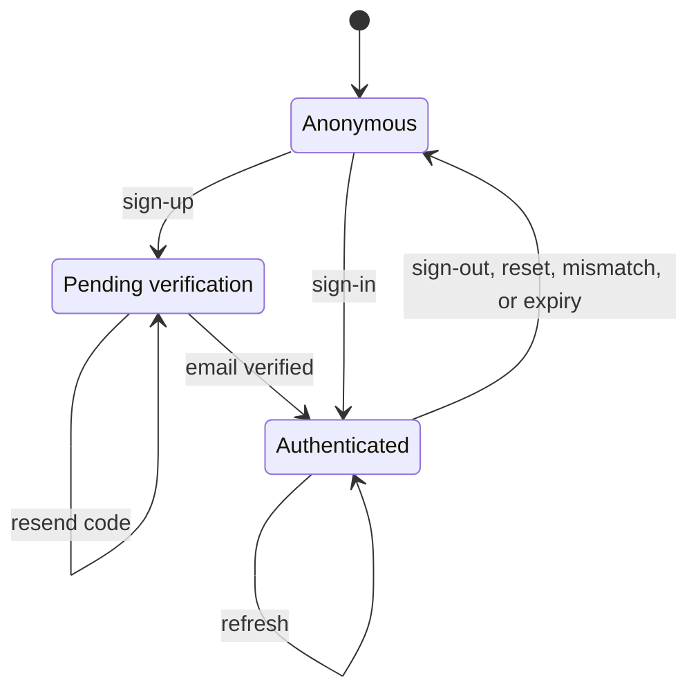

# Authentication

Authentication creates Backend accounts, verifies email addresses, and manages user sessions with email and password credentials.

> **Status:** Planned design. No API behavior is implemented unless source code proves otherwise.

The [API outline](../api/api-design-outline.md) owns the auth endpoints, error codes, and OpenAPI notes. The [database guide](../database/database.md) explains session and auth-code modeling; [schema.dbml](../database/schema.dbml) holds the canonical definitions. Workspace access and membership are out of scope for this page; non-members receive `404 NOT_FOUND` on workspace resources per the API outline.

## 1. Workflows

### Create account

- **Where:** Create Account screen.
- **Flow:**
  1. The user submits a name, email, and password.
  2. The frontend sends `POST /api/v1/auth/sign-up` with `{ name, email, password }`.
  3. The Backend validates the fields and normalizes the email to lowercase.
  4. For a new email, the Backend creates an unverified user, creates a verification code, and sends the verification email.
  5. For an existing unverified email, the Backend updates the name and password, invalidates prior verification codes, creates a new code, and sends the verification email.
  6. For an existing verified email, the Backend sends an account-exists email instead and reveals nothing about the existing account.
  7. All cases return the same generic `202 Accepted`.
  8. No session is created before verification.
- **Errors:**
  - `422 VALIDATION_ERROR`: a field is missing or invalid.
  - `429 RATE_LIMITED`: the sign-up rate limit is exceeded.

### Verify email

- **Where:** Check your email and the verification-code entry.
- **Flow:**
  1. The frontend sends `POST /api/v1/auth/verify-email` with `{ email, code }`.
  2. The Backend hashes the submitted code and validates the hash before checking expiry, attempt count, and single use.
  3. The Backend sets `is_verified = true`, consumes the code, and creates a session.
  4. The Backend returns `200` with an access token and the user, and sets the refresh cookie.
  5. A resend request uses `POST /api/v1/auth/resend-verification` with `{ email }`.
  6. For an unverified account outside cooldowns, the Backend invalidates the previous code, sends a new code, and returns a generic `202`. Verified or unknown emails return the same `202` with no email sent. Requests inside the 60-second cooldown return `429 RATE_LIMITED`.
- **Errors:**
  - `422 INVALID_VERIFICATION_CODE`: the code is wrong, exhausted, consumed, or unknown.
  - `422 VERIFICATION_CODE_EXPIRED`: a matching code has expired.
  - `429 RATE_LIMITED`: the resend cooldown or rate limit is exceeded.
- **Rules:**
  - Verification codes are 6 digits, hashed with HMAC-SHA-256 and a server pepper, with a 10-minute expiry.
  - A code allows 5 attempts, is single-use, and has a 60-second resend cooldown.
  - The resend cooldown is keyed to the normalized email and client IP and applies whether or not the account exists; unknown and verified emails receive the same response sequence and no email is sent.
  - The resend response is generic so it does not reveal whether an account exists.

### Sign in

- **Where:** Sign in screen.
- **Flow:**
  1. The frontend sends `POST /api/v1/auth/sign-in` with `{ email, password }`.
  2. The Backend verifies the credentials against the Argon2id password hash.
  3. A wrong email or password returns a generic `401 INVALID_CREDENTIALS`.
  4. Correct credentials for an unverified email return `403 EMAIL_NOT_VERIFIED`; the frontend offers resend.
  5. A successful sign-in creates a session, returns `200` with an access token and the user, and sets the refresh cookie.
- **Errors:**
  - `401 INVALID_CREDENTIALS`: the email or password is wrong.
  - `403 EMAIL_NOT_VERIFIED`: the email address is not verified.
  - `429 RATE_LIMITED`: the sign-in rate limit is exceeded.

### Refresh session

- **Where:** Any authenticated request after the access token expires.
- **Flow:**
  1. The frontend sends `POST /api/v1/auth/refresh` with the refresh cookie.
  2. The Backend verifies the hashed refresh token, rotates it, and returns a new access token and the user.
  3. The response sets the new refresh cookie.
  4. A missing, invalid, or revoked token returns `401 SESSION_EXPIRED`.
  5. A token mismatch outside a brief grace window for concurrent refreshes revokes the session.
  6. Refresh returns the user; there is no separate `GET /auth/me`.
- **Errors:**
  - `401 SESSION_EXPIRED`: the session is missing, expired, revoked, or mismatched.
- **Rules:**
  - The refresh token is an opaque `<session_id>.<secret>` value. Only the secret hash is stored, so a stale token still identifies its session and a mismatch outside the grace window revokes that session.

### Sign out

- **Where:** Any authenticated screen.
- **Flow:**
  1. The frontend sends `POST /api/v1/auth/sign-out` with the refresh cookie.
  2. The Backend revokes the current session if present and clears the refresh cookie.
  3. The Backend returns `204 No Content`.

### Request password reset

- **Where:** Reset Password screen.
- **Flow:**
  1. The frontend sends `POST /api/v1/auth/password-reset/request` with `{ email }`.
  2. The Backend returns a generic `202 Accepted` when the request is accepted.
  3. When the account exists, the Backend invalidates any active reset code, creates a new reset code, and sends the reset email.
  4. A request inside the 60-second cooldown or over the rate limit returns `429 RATE_LIMITED`.
- **Errors:**
  - `429 RATE_LIMITED`: the cooldown or rate limit is exceeded.
- **Rules:**
  - The accepted response does not reveal whether the email belongs to an account.
  - The cooldown is keyed to the normalized email and client IP and applies to every request, including emails without an account. Unknown emails follow the same `202`/`429` sequence and no email is sent.

### Set new password

- **Where:** Set a new password screen.
- **Flow:**
  1. The reset-code entry screen, absent from the current designs, holds the code in client state until this call.
  2. The frontend sends `POST /api/v1/auth/password-reset/confirm` with `{ email, code, newPassword }`.
  3. The Backend validates password strength first, then validates the code using the same hash-before-expiry ordering as verification.
  4. The Backend updates the password hash, sets `is_verified = true`, consumes the code, and revokes all user sessions.
  5. The Backend returns `204 No Content`.
- **Errors:**
  - `422 INVALID_RESET_CODE`: the code is wrong, exhausted, consumed, or unknown.
  - `422 RESET_CODE_EXPIRED`: a matching code has expired.
  - `422 WEAK_PASSWORD`: the password does not meet the minimum length.
  - `429 RATE_LIMITED`: the rate limit is exceeded.
- **Rules:**
  - Passwords use Argon2id and require at least 12 characters.
  - Reset codes use the same 6-digit, HMAC-SHA-256, 10-minute expiry, 5-attempt, single-use rules as verification codes.

## 2. Session states

- The access token lives about 15 minutes. The refresh token has a 30-day absolute lifetime, is rotated on refresh with a brief grace window for concurrent requests, and is stored as a hash in `sessions`.
- Sign-out, password reset, and refresh-token mismatch outside the grace window revoke sessions. A revoked session cannot refresh.
- Revoking a session stops refresh immediately. An access token already issued remains valid until it expires, about 15 minutes; immediate access-token revocation is not part of this design.
- Pending verification has no session; verification or password reset confirms email ownership before authentication.

## 3. Future work

- Workspace selection, creation, membership, invitations, roles, and member management.
- MFA, SSO/social login, email change, account deletion, and remember-me.
- Session-management UI and active-session listing.
- Email delivery is asynchronous and provider-agnostic; provider selection, delivery retries, and an outbox are future work.

## 4. Decisions

No ADR; this section records the rationale.

- **Short access token and rotating refresh session.** Keeps access checks stateless while revoking refresh cookies on sign-out, password reset, or reuse outside the concurrent-refresh grace window.
- **Verify before sign-in.** Sign-up creates no session and overwrites only unverified accounts until email ownership is proven.
- **Generic responses and uniform cooldowns.** Sign-up, resend, reset, and sign-in avoid account enumeration, including for unknown emails.
