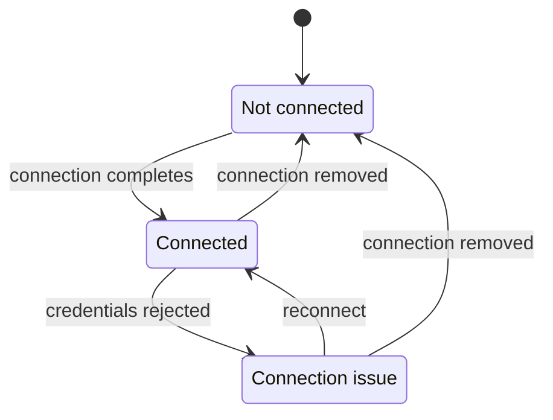

# Integrations

Integrations connect a workspace to an external system through code-defined providers and per-workspace connections.

> **Status:** Planned design. No API behavior is implemented unless source code proves otherwise.

Action availability and agent grants are owned by [Actions](actions.md).

## 1. Workflows

### Browse integrations

- **Where:** Integrations page.
- **Flow:**
  1. The frontend sends `GET /workspaces/{workspace_id}/integrations`.
  2. The Backend returns integrations and summary stats.
  3. Each integration includes its key, connection status, connected account, last validation, and supported action count.
  4. The frontend renders the integration list.
- **Rules:**
  - `connectionStatus` is `connected`, `invalid`, or `not_connected`; the frontend labels these `Connected`, `Connection issue`, and `Not connected`.

### Inspect an integration

- **Where:** Integration detail.
- **Flow:**
  1. The frontend sends `GET /workspaces/{workspace_id}/integrations/{integration_key}`.
  2. The Backend returns connection status, connected account, last validation, and supported actions.
  3. Each action includes its tool key and workspace availability.
  4. The frontend renders the integration detail.
- **Errors:**
  - `404 NOT_FOUND`: the workspace or integration does not exist.

### Connect an integration

- **Where:** Integrations page, integration detail, and provider consent.
- **Flow:**
  1. The frontend sends `POST /workspaces/{workspace_id}/integrations/{integration_key}/oauth/start`.
  2. The Backend returns the provider authorization URL.
  3. The browser opens the provider consent screen.
  4. The provider redirects to `GET /api/v1/integrations/oauth/callback`.
  5. The Backend completes the connection and redirects to the frontend.
  6. The frontend shows the connected integration and available actions.
- **Errors:**
  - `404 NOT_FOUND`: the workspace or integration does not exist.
  - `409 INTEGRATION_ALREADY_CONNECTED`: a healthy connection already exists. The user must remove it before connecting a different account.
  - Provider errors return to the frontend with a safe error code.
- **Rules:**
  - An invalid connection can be reconnected in place through the same flow. Reconnecting replaces credentials and account metadata while preserving workspace action settings and agent grants.

### Remove an integration connection

- **Where:** Integration detail.
- **Flow:**
  1. The frontend sends `DELETE /workspaces/{workspace_id}/integrations/{integration_key}/connection`.
  2. The Backend removes the connection, credentials, and OAuth state.
  3. It deletes workspace action settings and agent action grants for the integration's tool keys.
- **Errors:**
  - `404 NOT_FOUND`: the workspace or connection does not exist.

## 2. Connection states

- `Not connected`: no active credentials. The integration's actions are unavailable.
- `Connected`: credentials are valid. The integration's actions are available.
- `Connection issue`: the provider rejected access or credentials can no longer be refreshed. Actions are unavailable until the user reconnects.
- Removing a connection returns the integration to `Not connected`.

OAuth connection mechanics are owned by [ADR-0007](../adr/ADR-0007-oauth-provider-integrations.md). This page owns the user-facing connection lifecycle.

## 3. Future work

- Different connection methods such as API keys.

## 4. Decisions

- Integration definitions and provider adapters live in code. Database rows represent workspace connection state only, including OAuth state.
- Frontend localization owns integration names, descriptions, and category labels. The Backend returns stable keys only.
