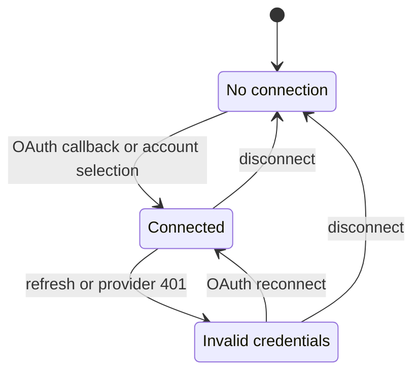

# Integrations

Integrations connect a workspace to an external system. Integration definitions, OAuth client settings, scopes, supported actions, and adapters live in the Backend code registry. The database stores workspace connections, encrypted OAuth tokens, external account details, and connection state. The frontend maps each `integration_key` to localized labels, descriptions, and category.

## 1. Workflows

### Browse integrations

- **Where:** Integrations & Actions page, Integrations tab.
- **Endpoint:** `GET /workspaces/{workspace_id}/integrations`
- **Flow:**
  1. The frontend loads summary stats for total integrations, connected, connection issues, and available actions.
  2. The API returns integration keys, connection status, last validation, and supported action counts. The frontend localizes integration names, descriptions, and categories.
  3. `connectionStatus` is `connected`, `invalid`, or `null`; the UI labels these `Connected`, `Connection issue`, and `Not connected`.
  4. A `null` status shows `Connect`, an `invalid` status shows `Reconnect`, and a connected integration opens its detail.
- **Outcome:** The integration list and connection actions render.

### Inspect an integration

- **Where:** Integration detail.
- **Endpoint:** `GET /workspaces/{workspace_id}/integrations/{integration_key}`
- **Flow:**
  1. The frontend loads the integration key and its workspace connection, then maps the key to localized display text.
  2. Disabled integrations return `404 NOT_FOUND`.
  3. The detail shows the connected external account, granted scopes, last validation, and available actions.
- **Outcome:** The integration detail and connection state render.

### Start OAuth connection

- **Where:** Integrations page, `Connect Integration`; integration detail, `Reconnect`.
- **Endpoint:** `POST /workspaces/{workspace_id}/integrations/{integration_key}/oauth/start`
- **Flow:**
  1. The frontend loads integration keys and maps them to localized names, descriptions, categories, and connection actions.
  2. The Backend validates workspace membership, the integration key, and the code registry entry.
  3. It generates a random state value, stores only its SHA-256 hash with the workspace, integration, initiating user, backend callback URI, optional return path, and a 10 minute expiry. Return paths must be relative or allowlisted.
  4. It builds the provider authorization URL from the code registry.
  5. The URL includes the provider client ID, scopes, exact redirect URI, state, `response_type=code`, and provider-specific authorization parameters from the code registry.
  6. The endpoint returns the authorization URL and expiry.
  7. The frontend navigates the browser to the provider.
- **Outcome:** The user is at the provider consent screen. Tokens are not requested by the frontend.
- **Errors:**
  - `404 NOT_FOUND`: the workspace or integration does not exist.
  - `409 INTEGRATION_DISABLED`: the integration is disabled in the code registry.
  - `409 OAUTH_ALREADY_PENDING`: a valid pending authorization already exists for this workspace integration.

### Handle OAuth callback

- **Where:** Public Backend callback reached by the provider redirect.
- **Endpoint:** `GET /api/v1/integrations/oauth/callback?code=&state=&error=`
- **Flow:**
  1. The provider redirects the browser with a code or an OAuth error.
  2. The Backend hashes the state, looks it up, verifies expiry and workspace, and consumes it once.
  3. If the provider returned an error, the Backend redirects to the configured frontend base with a safe error code.
  4. The Backend exchanges the authorization code at the provider token endpoint with the client ID, client secret, and exact redirect URI.
  5. The Backend fetches accessible provider accounts using the account discovery settings in the code registry, including account ID, name, URL, and granted scopes.
  6. If no account is available, the Backend redirects with an error.
  7. If one account is available, the Backend encrypts the token set, stores the connection, and redirects to the frontend success state.
  8. If multiple accounts are available, the Backend stores a short-lived pending connection and redirects to the provider account selection state.
- **Outcome:** The browser returns to the frontend. Access tokens and refresh tokens never appear in the URL or frontend state.
- **Errors:** OAuth failures redirect with an error code instead of returning a JSON response. Invalid, expired, or consumed state is rejected without revealing connection data.

### Select a provider account

- **Where:** Frontend account selection after a multi-account callback.
- **Endpoints:**
  - `GET /workspaces/{workspace_id}/integrations/{integration_key}/oauth/pending/{pending_id}`
  - `POST /workspaces/{workspace_id}/integrations/{integration_key}/oauth/complete`
- **Flow:**
  1. The frontend loads the pending connection and its accessible provider accounts. Pending selections also expire after 10 minutes.
  2. The user selects one account.
  3. The Backend verifies membership, ownership, expiry, and that the account ID is in the pending account list.
  4. It encrypts the token set, stores the connection with the external account ID and name, and consumes the pending record.
- **Outcome:** The provider account is connected. Its registry actions become available in the workspace and default to enabled when no override exists.
- **Errors:**
  - `404 NOT_FOUND`: the pending connection or account does not exist.
  - `409 PENDING_ALREADY_CONSUMED`: the pending connection was already completed.
  - `410 PENDING_EXPIRED`: the selection window expired; start OAuth again.

### Disconnect

- **Where:** Integration detail, `Disconnect`.
- **Endpoint:** `DELETE /workspaces/{workspace_id}/integrations/{integration_key}/connection`
- **Flow:**
  1. The Backend deletes the connection and its encrypted tokens.
  2. It deletes OAuth states and pending connections for that workspace integration.
  3. It deletes workspace action settings and agent action grants for the integration's tool keys.
- **Outcome:** The integration is disconnected and its actions disappear from the workspace. Reconnecting starts with default enabled actions.
- **Errors:**
  - `404 NOT_FOUND`: no connection exists.

## 2. Connection health

- A provider `401` during tool execution marks the connection `invalid`.
- Invalid credentials make the integration's workspace actions `Unavailable` while preserving their settings and agent grants.
- Before a provider call, the Backend refreshes the access token when it is within 60 seconds of expiry.
- Providers that rotate refresh tokens require the Backend to replace the access token and refresh token together under a row lock.
- A failed refresh, revoked grant, or `invalid_grant` marks the connection `invalid` and requires OAuth reconnect.
- Invalid credentials keep workspace action settings and agent grants, but make the actions `Unavailable`.
- A `403`, `5xx`, or timeout is an execution failure, not a connection-state change.
- A disconnected or invalid integration is omitted from the agent's next turn tool list.
- The Backend rechecks the integration connection when `tools/call` executes; a call against an unavailable integration returns `integration_not_connected`.
- The AI Service is not notified when a workspace connects or disconnects an integration.

## 3. OAuth provider profile

Each integration in the code registry defines:

| Field | Purpose |
| --- | --- |
| `authorization_url` | Provider consent page URL. |
| `token_url` | Authorization code and refresh token exchange URL. |
| `client_id_env` | Runtime environment variable name for the OAuth client ID. |
| `client_secret_env` | Runtime environment variable name for the OAuth client secret. |
| `scopes` | Scopes requested during authorization. |
| `authorization_params` | Optional provider parameters such as audience or prompt. |
| `account_discovery_url` | Endpoint that lists accounts available to the token. |
| `account_id_field` | Response field used as the external account ID. |
| `account_name_field` | Response field used as the external account display name. |
| `account_url_field` | Optional response field used as the external account URL. |
| `api_base_url` | Provider API base URL template for tool calls. |
| `refresh_token_rotation` | Whether refresh tokens are replaced on refresh. |
| `token_endpoint_auth_method` | Client secret transport expected by the token endpoint. |

The callback URL must exactly match the redirect URI registered with the provider. Client credentials stay in Backend runtime configuration. Provider OAuth configuration and client credentials never appear in frontend code or database rows. Adding a provider requires a registry entry and adapter; the OAuth state, callback, storage, and token refresh flow stay the same.

## 4. Future work

- Scope expansion and re-consent when required permissions change.
- Provider token revocation on disconnect.
- Additional OAuth providers.

## 5. Decisions

- Integration definitions and provider adapters live in code. Database rows represent workspace connection state only, including OAuth state and pending account selections.
- Frontend localization owns integration names, descriptions, and category labels. The Backend returns stable keys only.
- OAuth authorization uses the code flow with one-time state and a Backend callback.
- OAuth tokens are encrypted with AES-256-GCM and never leave the Backend.
- Rotating refresh tokens are replaced atomically.
- Multi-account providers require explicit account selection.
- Disconnecting removes connection credentials, workspace action settings, and agent action grants.
- Invalid credentials keep action settings and agent grants but make actions unavailable.
- Global integration availability changes with the code registry, not a database row.
