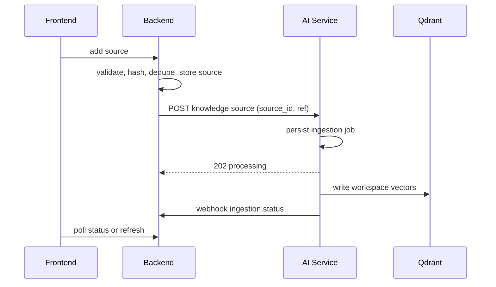

# Knowledge

Workspace Knowledge is the only source library. Each source belongs to one workspace and is ingested into Qdrant once. Agents select the workspace sources they use; there are no agent-specific sources. A source can be assigned to an agent only when it is ready and belongs to the agent's workspace.

> **Status:** Planned design. No API behavior is implemented unless source code proves otherwise.

Agent source selection is configured in [Agents](agents.md).

## 1. Workflows

### Browse workspace knowledge

- **Where:** Workspace Knowledge page.
- **Endpoint:** `GET /workspaces/{workspace_id}/knowledge?page=1&limit=20&search=&type=&status=`
- **Flow:**
  1. The page loads a paginated workspace source library.
  2. The table shows source name, type, availability, date, and a More menu.
  3. Availability is `Ready`, `Processing`, or `Failed`. Search and filters narrow the list.
  4. The More menu opens Source Availability, which shows the assigned agent count and remove action.
- **Outcome:** The library renders newest first.
- **Rules:**
  - Paginated with the shared defaults and maximum.
  - Search matches source name and description; type and status filter the source list.

### Add a source

- **Where:** Workspace Knowledge page, `Add knowledge source`.
- **Endpoint:** `POST /workspaces/{workspace_id}/knowledge`
- **AI handoff:** `POST /workspaces/{workspace_id}/knowledge-sources`
- **Flow:**
  1. Choose File Upload or Website URL.
  2. Files must be PDF, DOCX, or TXT up to 10 MB. A website URL must be publicly reachable.
  3. Enter a source name and an optional description.
  4. The Backend validates the source, hashes its content, and checks for a duplicate in the workspace.
  5. If the content already exists, the Backend reuses that source without re-ingestion. Otherwise it stores a new source with a `source_id` and sends it to the AI Service with a `ref`.
  6. The AI Service persists the job and returns `202`. It then ingests chunks into Qdrant.
  7. The AI Service reports completion through `ingestion.status`; the source becomes Ready or Failed.
- **Outcome:** The source appears in the library. Once Ready, it can be assigned to agents.
- **Errors:**
  - `422 VALIDATION_ERROR`: unsupported type, invalid URL, invalid file, or invalid source name.
  - `413 PAYLOAD_TOO_LARGE`: the file exceeds 10 MB.
  - `503 UPSTREAM_UNAVAILABLE`: storage or the AI Service is unavailable; `details.service` identifies which one.

### Configure agent knowledge

- **Where:** Agent creation, Configure Knowledge; Agent detail, `Edit Agent`, Configure Knowledge.
- **Endpoints:**
  - `GET /workspaces/{workspace_id}/agents/{agent_id}/knowledge?page=1&limit=20&search=`
  - `PUT /workspaces/{workspace_id}/agents/{agent_id}/knowledge`
- **Flow:**
  1. The source picker lists workspace sources. Only Ready sources can be selected.
  2. The user selects the sources the agent may use.
  3. The Backend validates that every selected source belongs to this workspace and is ready, then replaces the agent's assignments.
  4. During creation, Review & save shows the selected source count.
- **Outcome:** The agent retrieves only its selected workspace sources.
- **Rules:**
  - The available-source list is paginated; the current selected source IDs are returned separately.
  - Assignment does not copy or re-ingest the source.
  - Only assigned sources are retrieved for the agent.
  - A source can be assigned to many agents.
  - Processing and Failed sources cannot be assigned.
  - A source from another workspace is rejected even if the client supplies its ID.
- **Errors:**
  - `422 VALIDATION_ERROR`: a selected source does not exist in this workspace or is not ready.

### Retry a failed source

- **Where:** Knowledge table, More, Source Availability.
- **Endpoint:** `POST /workspaces/{workspace_id}/knowledge/{source_id}/retry`
- **AI handoff:** `POST /workspaces/{workspace_id}/knowledge-sources/{source_id}/retry`
- **Flow:**
  1. The Backend verifies the source is Failed and supplies a fresh `ref` when needed.
  2. The AI Service re-queues ingestion and returns `202`.
- **Outcome:** The source returns to Processing.
- **Errors:**
  - `404 NOT_FOUND`: the source does not exist.
  - `409 SOURCE_NOT_FAILED`: the source is not failed.
  - `503 UPSTREAM_UNAVAILABLE`: the AI Service is unavailable.

### Remove a source

- **Where:** Knowledge table, More, Source Availability; confirmation dialog.
- **Endpoint:** `DELETE /workspaces/{workspace_id}/knowledge/{source_id}`
- **AI handoff:** `DELETE /workspaces/{workspace_id}/knowledge-sources/{source_id}`
- **Flow:**
  1. The confirmation names the source and warns that agent assignments will be removed.
  2. The Backend asks the AI Service to purge the source vectors. If the AI Service is unavailable, the source and assignments remain.
  3. After a successful purge, the Backend deletes the source, its assignments, metadata, and private file object.
- **Outcome:** The source, its agent assignments, and its vectors are removed.
- **Errors:**
  - `404 NOT_FOUND`: the source does not exist.
  - `503 UPSTREAM_UNAVAILABLE`: the AI Service is unavailable; the source and assignments remain and the delete can be retried.

## 2. Ingestion and retrieval

- Supported source types: PDF, DOCX, Plaintext (TXT), and Website URL.
- Source identity is content-based: normalized URLs and cryptographic hashes for files.
- A source is stored once per workspace and can be assigned to many agents.
- Ingestion is asynchronous. The AI Service persists the job before returning `202`; jobs survive restarts.
- Availability is `ready`, `processing`, or `failed`. The AI Service reports changes through `ingestion.status`.
- Qdrant vectors carry `workspace_id` and `source_id`.
- The Backend sends selected source IDs in `agent_config`. Retrieval is limited to those IDs.
- Deleting an agent removes its assignments; workspace sources remain.
- The AI Service owns parsing, chunking, embedding, vector writes, and purges. The Backend owns source metadata, assignments, hashing, and deduplication.

## 3. Future work

- Source versioning and bulk upload.
- Scheduled URL re-ingestion.
- Access policies beyond workspace membership.

## 4. Decisions

- Workspace Knowledge is the only source library; agents select from it.
- Sources are stored once per workspace and can serve many agents.
- Assignment does not copy or re-ingest a source.
- Deleting a source requires a successful vector purge before local deletion.
- The AI Service owns ingestion and vectors; the Backend owns metadata and assignments.
