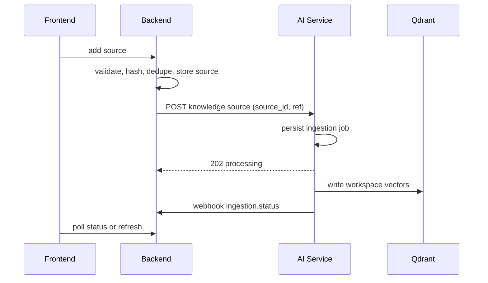

# Knowledge

Workspace Knowledge is the only source library for agents.

> **Status:** Planned design. No API behavior is implemented unless source code proves otherwise.

Agent source assignments are configured in [Agents](agents.md).

## 1. Workflows

### Browse workspace knowledge

- **Where:** Workspace Knowledge page.
- **Flow:**
  1. The frontend sends `GET /workspaces/{workspace_id}/knowledge?page=1&limit=20&search=&type=&status=` and loads a paginated workspace source library.
  2. The frontend shows source name, type, availability, date, and source actions.
  3. Availability is `Ready`, `Processing`, or `Failed`.
  4. Search and filters narrow the list.
  5. The frontend shows the assigned agent count and removal option.
  6. The list is sorted by newest first.

### Add a source

- **Where:** Workspace Knowledge page.
- **Flow:**
  1. The user selects a file upload or website URL.
  2. Files must be PDF, DOCX, or TXT up to 10 MB.
  3. A website URL must be publicly reachable.
  4. The user enters a source name and optional description.
  5. The frontend sends `POST /workspaces/{workspace_id}/knowledge`.
  6. The Backend validates, hashes the content, and checks for a duplicate.
  7. If the content exists, it returns `409 DUPLICATE_SOURCE` with `details` identifying the existing source.
  8. It does not create a source, ingest again, or overwrite the existing metadata.
  9. Otherwise it stores a new source with a `source_id` and sends `POST /workspaces/{workspace_id}/knowledge-sources` to the AI Service with `source_id` and `ref`.
  10. The AI Service starts ingestion and returns `202`.
  11. The AI Service reports completion through `ingestion.status`; the source becomes `Ready` or `Failed`.
- **Errors:**
  - `409 DUPLICATE_SOURCE`: the content already exists in this workspace; `details` includes the existing source's `sourceId`, `name`, and `availability`.
  - `422 VALIDATION_ERROR`: unsupported type, invalid URL, invalid file, or invalid source name.
  - `413 PAYLOAD_TOO_LARGE`: the file exceeds 10 MB.
  - `503 UPSTREAM_UNAVAILABLE`: storage or the AI Service is unavailable; `details.service` identifies which one.

### Retry a failed source

- **Where:** Knowledge table.
- **Flow:**
  1. The frontend sends `POST /workspaces/{workspace_id}/knowledge/{source_id}/retry`.
  2. The Backend verifies the source is `Failed` and supplies a fresh `ref` when needed.
  3. The Backend sends `POST /workspaces/{workspace_id}/knowledge-sources/{source_id}/retry` to the AI Service.
  4. The AI Service re-queues ingestion and returns `202`.
  5. The source returns to `Processing`.
- **Errors:**
  - `404 NOT_FOUND`: the workspace or source does not exist.
  - `409 SOURCE_NOT_FAILED`: the source is not failed.
  - `503 UPSTREAM_UNAVAILABLE`: the AI Service is unavailable.

### Remove a source

- **Where:** Knowledge table; confirmation step.
- **Flow:**
  1. The confirmation names the source and warns that agent assignments will be removed.
  2. The frontend sends `DELETE /workspaces/{workspace_id}/knowledge/{source_id}`.
  3. The Backend sends `DELETE /workspaces/{workspace_id}/knowledge-sources/{source_id}` to the AI Service to purge the source vectors.
  4. After a successful purge, the Backend deletes the source, its assignments, metadata, and private file object.
- **Errors:**
  - `404 NOT_FOUND`: the workspace or source does not exist.
  - `503 UPSTREAM_UNAVAILABLE`: the AI Service is unavailable; the source and assignments remain and the delete can be retried.

## 2. Ingestion and retrieval

- Source identity is content-based: normalized URLs and cryptographic hashes for files.
- A source is stored once per workspace and can be assigned to many agents.
- Ingestion is asynchronous.
- The AI Service persists the job before returning `202`; jobs survive restarts.
- Only `Ready` sources from the workspace can be assigned.
- The AI Service owns parsing, chunking, embedding, vector writes, and purges.
- The Backend owns source metadata, assignments, hashing, and deduplication.

## 3. Future work

- Source versioning and bulk upload.
- Scheduled website URL re-ingestion to avoid stale data after website updates.

## 4. Decisions

- Duplicate content is rejected and identifies the existing workspace source.