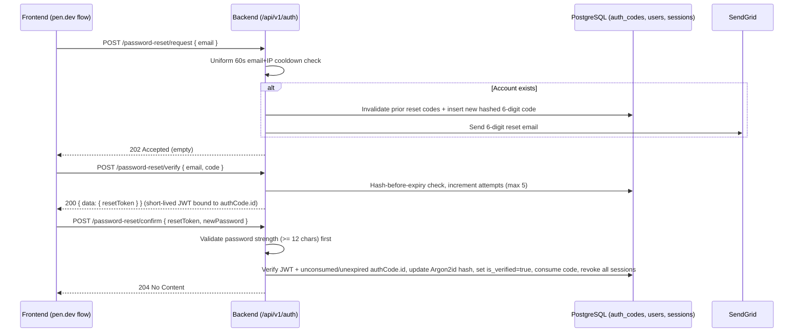

# Implementation plan: Authentication & Workspace Onboarding

> Historical implementation record. Current behavior is defined by [auth.md](../../features/auth.md) and [project-context.md](../../project-context.md); this file is not maintained as current API documentation.

Status: Done
Created: 2026-11-26
Updated: 2026-11-27 — the 60-second email+IP cooldown was removed; resend/reset now rely on per-IP route rate limits. Repeat sign-ups no longer overwrite credentials for unverified accounts. Email delivery failures return 503 UPSTREAM_UNAVAILABLE, the refresh cookie supports cross-site frontends via SameSite=None; Secure with an Origin check, and COOKIE_SECURE is derived from NODE_ENV rather than read from Infisical.
Feature brief: [brief.md](brief.md)

## 1. Goal

Implement the complete Backend authentication module (`/api/v1/auth/*`), workspace select/create endpoints (`/api/v1/workspaces/*`), and the required Express 5 application foundation (`createApp()`, global middleware, `AppError` hierarchy, error normalizer, graceful shutdown, and SendGrid email adapter) on branch `feature/auth` so the API matches all `Authent` UI screens on `pen.dev` and repository standards.

## 2. Authorization and scope

- **Authorized by:** User `/plan` request on `feature/auth` (plan-only; implementation starts after explicit approval).
- **In scope:**
  - Express 5 foundation: `createApp(deps)`, `server.ts` lifecycle, `requestId`, Pino redaction, `helmet`, allowlisted `cors`, `cookie-parser`, `express-rate-limit`, `validate` middleware, `notFoundMiddleware`, `AppError` hierarchy, and central error normalizer.
  - Auth module (`api/src/modules/auth/`): 9 endpoints (`sign-up`, `verify-email`, `resend-verification`, `sign-in`, `refresh`, `sign-out`, `password-reset/request`, `password-reset/verify`, `password-reset/confirm`) + `authenticate` bearer middleware.
  - Workspaces module (`api/src/modules/workspaces/`): 3 endpoints (`GET /api/v1/workspaces`, `POST /api/v1/workspaces`, `GET /api/v1/workspaces/:workspaceId`).
  - Crypto & token utilities: Argon2id password hashing, HMAC-SHA-256 6-digit auth codes & refresh-token secret hashing, `jose` JWT access tokens (~15m) & password-reset tokens (~10m).
  - SendGrid email adapter (`@sendgrid/mail`) behind an `EmailSender` interface (verification, account-exists, password-reset emails).
  - Interface-backed in-memory `CooldownStore` (uniform 60s email+IP cooldowns) and `RefreshGraceStore` (10s concurrent-refresh grace window).
  - Docs updates: `docs/features/auth.md`, `docs/features/workspaces.md` (new), and `docs/api/api-design-outline.md`.
  - Unit and Supertest integration tests (credential-free via injected `createApp(deps)`).
- **Out of scope:**
  - Multi-user workspace membership, invitations, and roles (only `workspaces.owner_id` exists in `schema.dbml`).
  - Database schema changes or running `database:migrate` (existing `users`, `sessions`, `auth_codes`, `workspaces`, `agents` tables cover all requirements).
  - Redis, email retry outbox, MFA, SSO, or OpenAPI YAML regeneration.
- **Decisions resolved with user (2026-11-26):**
  1. Add `POST /api/v1/auth/password-reset/verify` (`{ email, code }` → `200 { data: { resetToken } }`) to match the `pen.dev` reset-code verification screen (`code` / `code checking`) before `Set a new password`, and update auth docs.
  2. Include workspace select/create endpoints (`GET /api/v1/workspaces`, `POST /api/v1/workspaces`, `GET /api/v1/workspaces/:workspaceId`) and document them in `docs/features/workspaces.md`.
  3. Integrate SendGrid (`@sendgrid/mail`) behind `EmailSender`; use `express-rate-limit` for HTTP route rate limiting; keep `CooldownStore` and `RefreshGraceStore` behind interfaces with in-memory defaults.

## 3. Evidence and conventions

- **Product & technical state:** [docs/project-context.md](../../project-context.md)
- **Feature & API contracts:** [docs/features/auth.md](../../features/auth.md), [docs/api/api-design-outline.md](../../api/api-design-outline.md), [docs/standards/engineering-conventions.md](../../standards/engineering-conventions.md)
- **Express 5 mechanics & layer boundaries:** [docs/standards/express-conventions.md](../../standards/express-conventions.md), [api/eslint.config.mjs](../../../api/eslint.config.mjs)
- **Existing schema:** [api/src/database/auth.ts](../../../api/src/database/auth.ts) (`users`, `sessions`, `auth_codes`), [api/src/database/workspaces.ts](../../../api/src/database/workspaces.ts) (`workspaces`), [api/src/database/agents.ts](../../../api/src/database/agents.ts) (`agents`), [api/src/database/enums.ts](../../../api/src/database/enums.ts) (`auth_code_purpose`: `email_verification`, `password_reset`)

### Screen-to-API mapping (`pen.dev` `Authent` frame)

| `pen.dev` Screen(s) | Endpoint | Request | Success | Error Codes |
| --- | --- | --- | --- | --- |
| `Create Account` (`Z2vEm`) | `POST /api/v1/auth/sign-up` | `{ name, email, password }` | `202` (empty) | `422 VALIDATION_ERROR`, `422 WEAK_PASSWORD`, `429 RATE_LIMITED` |
| `Verify` / `Verify checking` / `Verify/fail` / `Verified` (`wCtKo`, `Rlrjd`, `KiajE`, `efxNa`) | `POST /api/v1/auth/verify-email` | `{ email, code }` | `200 { data: { accessToken, user } }` + refresh cookie | `422 INVALID_VERIFICATION_CODE`, `422 VERIFICATION_CODE_EXPIRED`, `429 RATE_LIMITED` |
| `Verify` / `Verify/fail` ("Resend code") | `POST /api/v1/auth/resend-verification` | `{ email }` | `202` (empty) | `422 VALIDATION_ERROR`, `429 RATE_LIMITED` (60s cooldown) |
| `Sign in` / `Checking` / `confirmed` / `fail` / `enter` (`oCGXC`, `ddX3W`, `URewe`, `QQ71U`, `fILRJ`) | `POST /api/v1/auth/sign-in` | `{ email, password }` | `200 { data: { accessToken, user } }` + refresh cookie | `401 INVALID_CREDENTIALS`, `403 EMAIL_NOT_VERIFIED`, `422 VALIDATION_ERROR`, `429 RATE_LIMITED` |
| `Sign in/expired` (`HNmTV`) + silent refresh | `POST /api/v1/auth/refresh` | Refresh cookie (`<sessionId>.<secret>`) | `200 { data: { accessToken, user } }` + rotated refresh cookie | `401 SESSION_EXPIRED` |
| `Sign out` button | `POST /api/v1/auth/sign-out` | Refresh cookie (optional — revokes session if present, always clears cookie) | `204` (clears cookie) | — |
| `Reset password` (`P7u56`) | `POST /api/v1/auth/password-reset/request` | `{ email }` | `202` (empty) | `422 VALIDATION_ERROR`, `429 RATE_LIMITED` (60s cooldown) |
| `code` / `code checking` / `Verify/fail` (`eytft`, `Fw7WR`, `KiajE`) | `POST /api/v1/auth/password-reset/verify` | `{ email, code }` | `200 { data: { resetToken } }` | `422 INVALID_RESET_CODE`, `422 RESET_CODE_EXPIRED`, `429 RATE_LIMITED` |
| `new password` (`rvaEM`) | `POST /api/v1/auth/password-reset/confirm` | `{ resetToken, newPassword }` | `204` | `422 WEAK_PASSWORD`, `422 INVALID_RESET_CODE`, `422 RESET_CODE_EXPIRED`, `429 RATE_LIMITED` |
| `Select a workspace` (`N7Fafr`) / `Workspace access fail` (`BYHoH`) | `GET /api/v1/workspaces` | `Authorization: Bearer` | `200 { data: [{ id, name, role: "owner", agentsCount, createdAt }] }` | `401 UNAUTHENTICATED` |
| `create workspace` (`ubOCs`) | `POST /api/v1/workspaces` | `Authorization: Bearer`, `{ name }` | `201 { data: { id, name, role: "owner", agentsCount: 0, createdAt } }` | `401 UNAUTHENTICATED`, `422 VALIDATION_ERROR` |
| `Workspace access restricted` (`X0u77`, `YPgOA`) | `GET /api/v1/workspaces/:workspaceId` | `Authorization: Bearer` | `200 { data: { id, name, role: "owner", agentsCount, createdAt } }` | `401 UNAUTHENTICATED`, `404 NOT_FOUND` (`details: [{ resource: "workspace" }]`), `422 VALIDATION_ERROR` |

### 2-step password reset flow

## 4. Affected areas

- **Dependencies (`api/package.json`):**
  - Add runtime: `argon2`, `jose`, `cookie-parser`, `helmet`, `cors`, `express-rate-limit`, `@sendgrid/mail`.
  - Add dev: `@types/cookie-parser`, `@types/cors`.
- **New Infisical runtime keys (`api/src/config/env.ts`):**
  - Export `EnvConfig` type and `envSchema` so tests can inject config without Infisical.
  - Add Zod-validated runtime vars (never `.env`): `TRUST_PROXY` (boolean/number, default `false`), `CORS_ORIGINS` (comma-separated string → `string[]`), `JWT_ACCESS_SECRET` (min 32 chars), `JWT_RESET_SECRET` (min 32 chars), `AUTH_CODE_PEPPER` (min 32 chars), `REFRESH_TOKEN_PEPPER` (min 32 chars), `SENDGRID_API_KEY`, `EMAIL_FROM` (email), `COOKIE_SECURE` (optional boolean, defaults to `NODE_ENV === 'production'`).
- **Existing files to update:**
  - `api/src/config/logger.ts` — export `createLogger(config)` and `createHttpLogger(logger)` with Pino redaction (`req.headers.authorization`, `req.headers.cookie`, `res.headers['set-cookie']`, `*.password`, `*.newPassword`, `*.token`, `*.refreshToken`, `*.accessToken`).
  - `api/src/app.ts` — refactor to pure `createApp(deps: AppDependencies)` factory following the mandatory middleware order in `docs/standards/express-conventions.md`:
    1. `app.set('trust proxy', deps.config.TRUST_PROXY)`
    2. `requestId`
    3. `httpLogger`
    4. `helmet()`
    5. `cors({ origin: deps.config.CORS_ORIGINS, credentials: true })`
    6. `cookieParser()`
    7. `express.json({ limit: '100kb' })`
    8. `GET /api/v1/health`
    9. `app.use('/api/v1', clientRouter)` (mounting `/auth` and `/workspaces`)
    10. `notFoundMiddleware`
    11. `errorHandlerMiddleware`
  - `api/src/server.ts` — load `env`, verify DB readiness (`SELECT 1`), wire real Drizzle repos + `SendGridEmailSender` + in-memory cooldown/grace stores into `createApp(deps)`, call `listen()`, log via Pino, and handle idempotent `SIGTERM`/`SIGINT` graceful shutdown + `unhandledRejection`/`uncaughtException`.
  - `api/tests/integration/app.test.ts` — migrate to `createApp(testDeps)` so it runs without Infisical credentials.
  - `docs/features/auth.md` & `docs/api/api-design-outline.md` — add `POST /api/v1/auth/password-reset/verify` and `Workspaces` select/create endpoints.
- **New files/directories:**
  - `docs/features/workspaces.md` — feature specification for workspace select, create, and detail access (using `docs/templates/feature-template.md` structure).
  - `api/src/errors/app-error.ts` — `AppError` base class (`statusCode`, `code`, `message`, `details?`, `isOperational = true`) and subclasses (`BadRequestError`, `UnauthorizedError`, `ForbiddenError`, `NotFoundError`, `ConflictError`, `UnprocessableEntityError`, `TooManyRequestsError`).
  - `api/src/errors/error-normalizer.ts` — maps `AppError`, `ZodError` (`422 VALIDATION_ERROR` with `{ field, code, params? }`), body-parser `SyntaxError` (`400 MALFORMED_REQUEST`), `entity.too.large` (`413 PAYLOAD_TOO_LARGE`), `jose` JWT errors (`401 UNAUTHENTICATED`), PG SQLSTATEs (`23505`, `23503`, `22P02`, `23514`, `40001`/`40P01`), and unknown errors (`500 INTERNAL_ERROR`, `isOperational = false`).
  - `api/src/middleware/request-id.ts` — validates incoming `X-Request-Id` (`[a-zA-Z0-9_-]`, max 128 chars) or generates UUID; sets `req.id` and response header.
  - `api/src/middleware/validate.ts` — validates `{ body?, query?, params? }`, normalizes `req.body ?? {}`, writes parsed values to `res.locals.validated` (never mutates `req.query`).
  - `api/src/middleware/not-found.ts` — forwards `NotFoundError` after all routers.
  - `api/src/middleware/error-handler.ts` — 4-arg handler; checks `res.headersSent`, normalizes error, logs `4xx` at `warn` and `5xx` at `error`, responds with `{ error: { code, details? } }`.
  - `api/src/middleware/rate-limit.ts` — thin wrapper around `express-rate-limit` forwarding `TooManyRequestsError` (`429 RATE_LIMITED`) to the global error handler.
  - `api/src/integrations/email/email-sender.ts` — `EmailSender` interface (`sendVerificationCode`, `sendAccountExistsNotice`, `sendPasswordResetCode`).
  - `api/src/integrations/email/sendgrid-email-sender.ts` — `@sendgrid/mail` implementation using `SENDGRID_API_KEY` and `EMAIL_FROM`.
  - `api/src/modules/auth/`:
    - `auth.crypto.ts` — Argon2id hash/verify (configurable cost for tests), `crypto.randomInt` 6-digit code, HMAC-SHA-256 + `timingSafeEqual` for codes & refresh secrets, `<sessionId>.<secret>` token format, `jose` JWT access (~15m) & reset (~10m, `sub: userId`, `jti: authCodeId`, `purpose: 'password_reset'`) tokens.
    - `auth.schemas.ts` — strict Zod v4 schemas + 12-char password rule (`WEAK_PASSWORD`).
    - `auth.mapper.ts` — maps `users` row to `{ id, name, email, isVerified, createdAt, updatedAt }` (ISO 8601 UTC; never exposes `passwordHash`).
    - `auth.stores.ts` — `CooldownStore` + `InMemoryCooldownStore` (60s email+IP cooldown), `RefreshGraceStore` + `InMemoryRefreshGraceStore` (10s concurrent-refresh grace window).
    - `auth.repository.ts` — Drizzle queries for `users`, `sessions`, `auth_codes` accepting optional `DbExecutor` (`Database | DbTransaction`).
    - `auth.service.ts` — pure business logic (no `express` imports): email normalization, hash-before-expiry ordering, 5-attempt cap, uniform 60s email+IP cooldowns, transactions around DB writes, `EmailSender` calls outside transactions, refresh rotation + grace window + reuse revocation.
    - `auth.controller.ts` — HTTP mapping, sets/clears refresh cookie (`HttpOnly`, `SameSite=Strict`, `Path=/api/v1/auth`, `Secure` per `COOKIE_SECURE`, `Max-Age=30d`).
    - `auth.routes.ts` — mounts all 9 endpoints with `validate(...)` and `express-rate-limit`.
    - `middleware/authenticate.ts` — verifies `Authorization: Bearer` JWT → `res.locals.auth = { userId, sessionId }` or throws `UnauthorizedError`.
  - `api/src/modules/workspaces/`:
    - `workspaces.schemas.ts` — `createWorkspaceSchema` (`{ name: string(1..50) }`) and `workspaceParamsSchema` (`{ workspaceId }`).
    - `workspaces.mapper.ts` — maps row + agent count to `{ id, name, role: 'owner', agentsCount, createdAt }`.
    - `workspaces.repository.ts` — `listByOwner`, `findOwnedById`, `createWorkspace` accepting optional `DbExecutor`.
    - `workspaces.service.ts` — pure business logic; non-owners or missing IDs throw `NotFoundError` with `details: [{ resource: 'workspace' }]`.
    - `workspaces.controller.ts` — reads `res.locals.auth.userId` and `res.locals.validated`, returns `{ data }`.
    - `workspaces.routes.ts` — mounts `GET /`, `POST /`, `GET /:workspaceId` behind `authenticate`.
  - `api/tests/unit/`: `errors.test.ts`, `auth.crypto.test.ts`, `auth.schemas.test.ts`, `auth.service.test.ts`, `workspaces.service.test.ts`.
  - `api/tests/integration/`: `auth.test.ts`, `workspaces.test.ts`.
- **Data, API, or compatibility effects:**
  - No database schema or migration changes required.
  - Adds 9 auth endpoints under `/api/v1/auth/*` and 3 workspace endpoints under `/api/v1/workspaces/*`.

## 5. Steps

1. **Update design docs** (`docs/features/auth.md`, new `docs/features/workspaces.md`, `docs/api/api-design-outline.md`) for `POST /api/v1/auth/password-reset/verify` and the 3 workspace select/create/detail endpoints. Run `bash bin/check-backend-docs.sh`.
2. **Install dependencies** in `api/`: `argon2`, `jose`, `cookie-parser`, `helmet`, `cors`, `express-rate-limit`, `@sendgrid/mail`, `@types/cookie-parser`, `@types/cors` (preserving `core.hooksPath`).
3. **Implement Express 5 foundation**:
   - `api/src/errors/app-error.ts` and `api/src/errors/error-normalizer.ts`.
   - `api/src/middleware/{request-id,validate,not-found,error-handler,rate-limit}.ts`.
   - Update `api/src/config/env.ts` and `api/src/config/logger.ts`.
   - Refactor `api/src/app.ts` to `createApp(deps)` and harden `api/src/server.ts` with DB readiness & graceful shutdown.
4. **Implement SendGrid email integration**:
   - `api/src/integrations/email/email-sender.ts` and `api/src/integrations/email/sendgrid-email-sender.ts`.
5. **Implement Auth & Workspaces modules** (`api/src/modules/auth/` and `api/src/modules/workspaces/`), and wire `/auth` and `/workspaces` routers into `/api/v1` in `api/src/app.ts`.
6. **Write unit & integration tests**:
   - Update `api/tests/integration/app.test.ts` to use `createApp(testDeps)`.
   - Add `api/tests/unit/{errors,auth.crypto,auth.schemas,auth.service,workspaces.service}.test.ts`.
   - Add `api/tests/integration/{auth,workspaces}.test.ts` covering all endpoints, cookies, error envelopes, validation `422`, malformed JSON `400`, `401`/`403`/`404`/`429`, and unexpected `500` non-leakage.
7. **Verify & review**:
   - Run `npm run lint --prefix api`, `npm run format:check --prefix api`, `npm run typecheck --prefix api`, `npm run build --prefix api`, `npm test --prefix api`, `bash bin/check-backend-docs.sh`, and `bash bin/check-agent-workflow.sh`.
   - Arrange a fresh-eyes review with the `reviewer` subagent and update `docs/project-context.md` upon completion.

## 6. Verification

| Check | Command or evidence |
| --- | --- |
| Unit & integration tests | `npm test --prefix api` (all suites pass without Infisical creds via `createApp(testDeps)`) |
| Lint & layer boundaries | `npm run lint --prefix api` |
| Typecheck & build | `npm run typecheck --prefix api && npm run build --prefix api` |
| Format check | `npm run format:check --prefix api` |
| Docs & harness checks | `bash bin/check-backend-docs.sh && bash bin/check-agent-workflow.sh` |

## 7. Risks and rollback

- **Risk:** `argon2` native build issues on Windows/Node 24 or slow CI hashing.
  - **Mitigation:** Verify `argon2` prebuilt binary loads on Node during install; allow configurable Argon2 cost parameters in test deps for fast unit/integration tests while keeping secure OWASP defaults in production.
- **Risk:** In-memory `express-rate-limit` store, `CooldownStore`, and `RefreshGraceStore` do not share state across multiple API replicas.
  - **Mitigation:** `express-rate-limit` supports pluggable Redis stores natively, and `CooldownStore` / `RefreshGraceStore` sit behind clean interfaces with bounded TTL cleanup so Redis implementations can be swapped in without changing `auth.service.ts`.
- **Risk:** New Infisical runtime secrets (`JWT_ACCESS_SECRET`, `JWT_RESET_SECRET`, `AUTH_CODE_PEPPER`, `REFRESH_TOKEN_PEPPER`, `SENDGRID_API_KEY`, `EMAIL_FROM`, `CORS_ORIGINS`, `TRUST_PROXY`) must be populated in Infisical environments before running `npm run dev` / `start`.
  - **Mitigation:** Document all new Infisical keys clearly in `api/README.md` / `docs/project-context.md` without ever recording secret values; keep unit/integration tests injectable so CI and local tests run without Infisical.
- **Risk:** Network email calls inside a DB transaction could hold connections open or fail inconsistently.
  - **Mitigation:** Execute DB transactions first, then invoke `EmailSender` outside the transaction; log send failures via Pino without leaking secrets or breaking enumeration safety.
- **Rollback:** All changes live on `feature/auth` with no database migrations; reverting the branch or commits cleanly restores the health-only scaffold.

## 8. Completion evidence

- Implemented Express 5 foundation, SendGrid email adapter, Auth module (9 endpoints across workflow-split services + shared bearer middleware), and Workspaces onboarding module (3 endpoints) using plain exported functions (zero `deps` threading, zero repository wrapper classes) and real in-memory PostgreSQL testing (`@electric-sql/pglite` + real Drizzle migrations).
- Fresh-eyes review (`reviewer` subagent) + PGlite PostgreSQL execution identified and resolved concurrency/security issues including: `is_verified = false` race guard, conditional refresh rotation, transactional `FOR UPDATE` OTP verification returning an outcome before throwing (preventing PG transaction rollback of `attempts + 1`), timing-safe `signIn`, `23505` handling, email outage non-enumeration, grace-store pruning, `closeIdleConnections()`, safe `500` logging, narrowed Pino redaction, `int4` max validation, remaining cookie `maxAge`, and `TRUST_PROXY` boolean guard.
- Checks verified: `npm run lint --prefix api`, `npm run typecheck --prefix api`, `npm run format:check --prefix api`, `npm run build --prefix api`, `npm test --prefix api` (9 files, 37 tests against PGlite PostgreSQL), `npm run openapi:check --prefix api`, `bash bin/check-backend-docs.sh`, `bash bin/check-agent-workflow.sh`.
